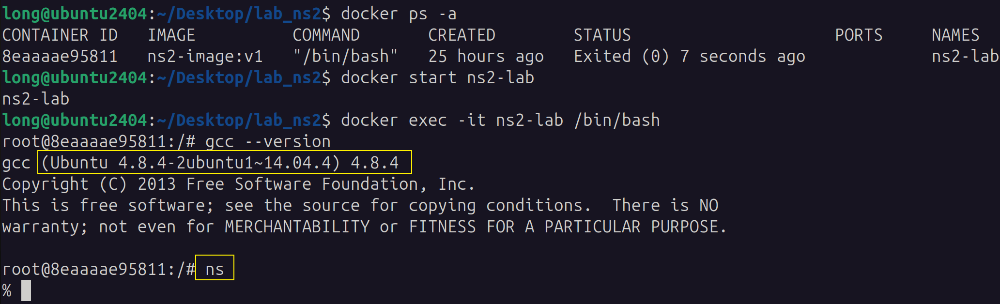
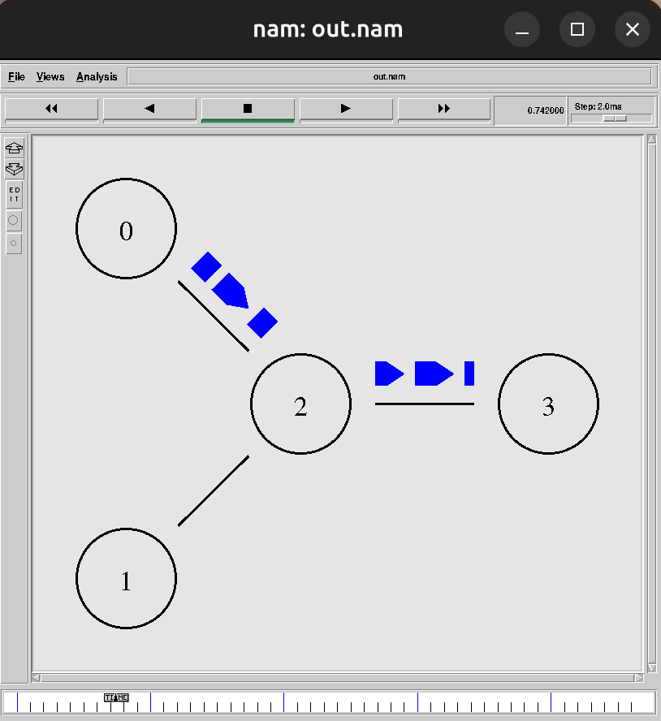
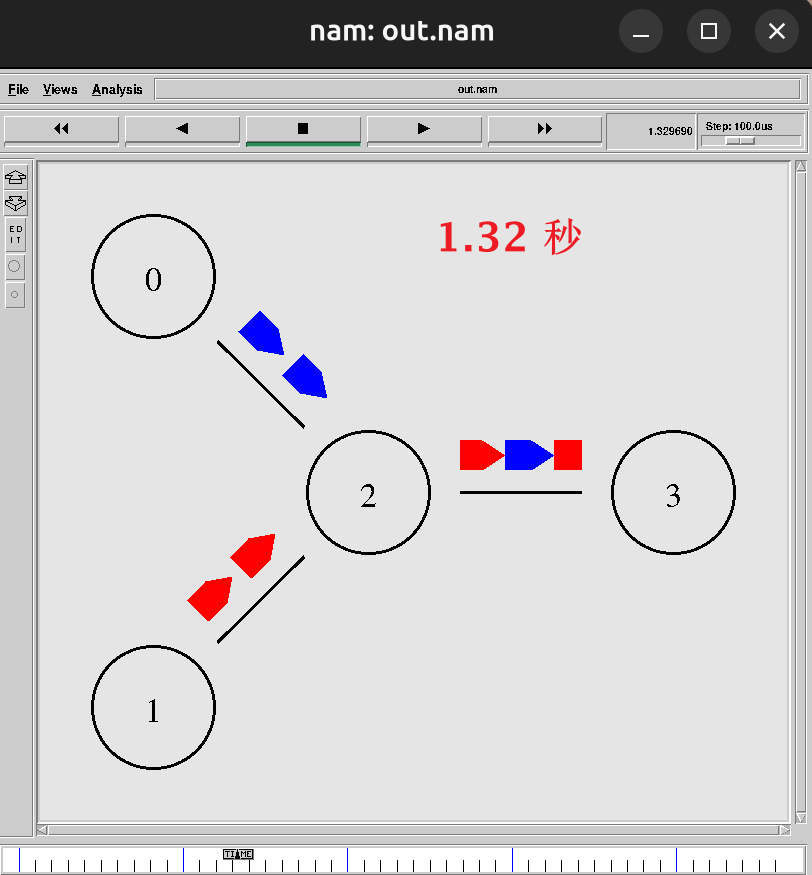
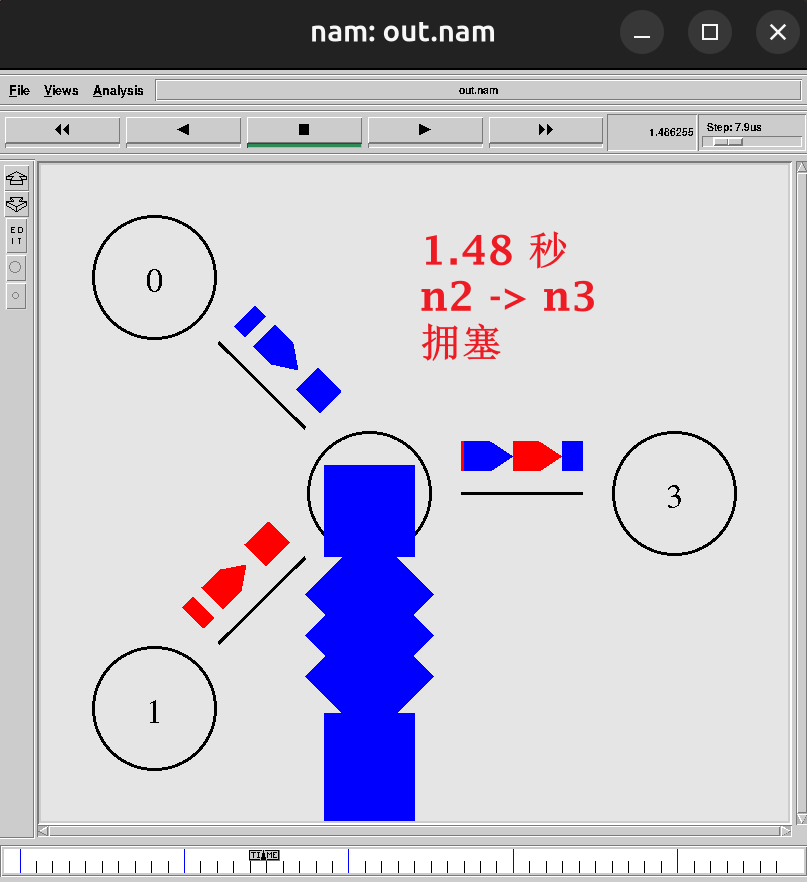
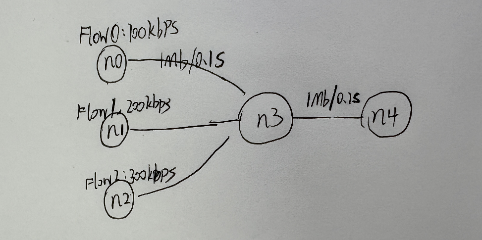
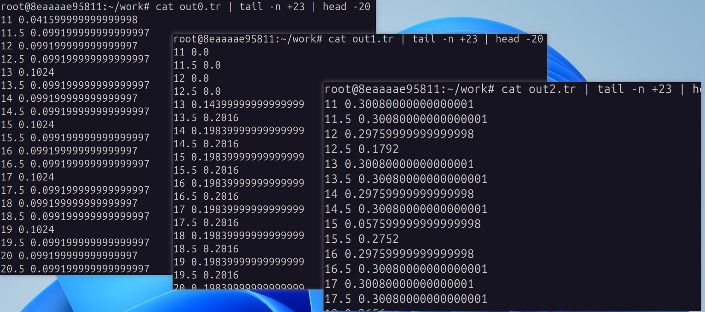
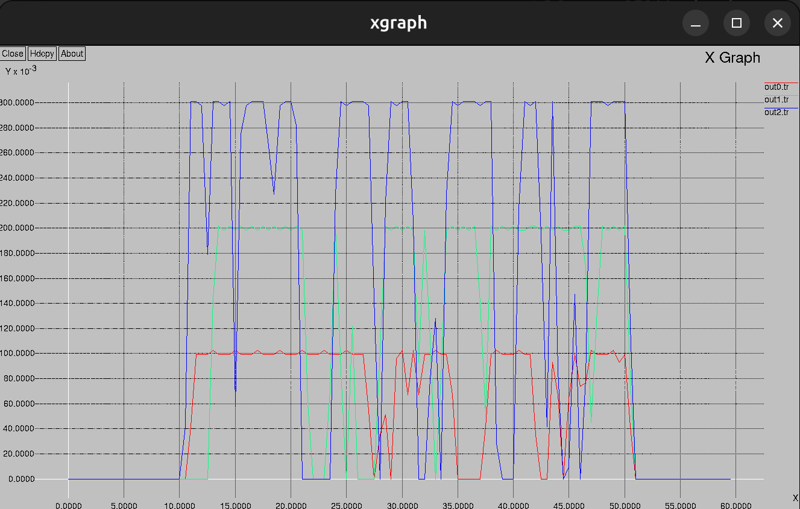

<h1 align="center">NS2 网络仿真实验报告</h1>

## 目录

- [目录](#目录)
- [一. 实验目的](#一-实验目的)
- [二. 实验原理](#二-实验原理)
- [三. 实验环境](#三-实验环境)
- [四. 实验一：四节点双 UDP 流量仿真](#四-实验一四节点双-udp-流量仿真)
  - [4.1 实验简介](#41-实验简介)
  - [4.2 网络拓扑](#42-网络拓扑)
  - [4.3 实验代码](#43-实验代码)
  - [4.4 实验步骤与现象分析](#44-实验步骤与现象分析)
    - [步骤 1：运行仿真](#步骤-1运行仿真)
    - [步骤 2：NAM 动画观察 —— 0.5s 时刻](#步骤-2nam-动画观察--05s-时刻)
    - [步骤 3：NAM 动画观察 —— 1.0s 时刻](#步骤-3nam-动画观察--10s-时刻)
    - [步骤 4：NAM 动画观察 —— 丢包现象](#步骤-4nam-动画观察--丢包现象)
    - [步骤 5：实验结果分析](#步骤-5实验结果分析)
- [五. 实验二：多流量并发仿真 + 自动绘图](#五-实验二多流量并发仿真--自动绘图)
  - [5.1 实验简介](#51-实验简介)
  - [5.2 网络拓扑](#52-网络拓扑)
  - [5.3 实验代码](#53-实验代码)
  - [5.4 实验步骤与现象分析](#54-实验步骤与现象分析)
    - [步骤 1：运行仿真](#步骤-1运行仿真-1)
    - [步骤 2：查看生成的数据文件](#步骤-2查看生成的数据文件)
    - [步骤 3：xgraph 曲线图分析](#步骤-3xgraph-曲线图分析)
    - [步骤 4：实验结果分析](#步骤-4实验结果分析)
- [六. 实验总结](#六-实验总结)
  - [6.1 核心收获](#61-核心收获)


## 一. 实验目的

1. **熟悉 NS2 的基本使用方法**：掌握 NS2 的安装部署、Tcl 脚本编写、仿真运行与结果查看的完整流程。
2. **掌握网络拓扑搭建**：通过 Tcl 脚本构建多节点网络拓扑，定义节点、链路属性（带宽、延迟、队列类型）。
3. **理解流量模型配置**：学习如何使用 CBR（恒定速率）和 Exponential（指数分布）等流量模型，模拟不同特征的网络数据传输。
4. **学习仿真结果分析**：通过 NAM 动画工具观察数据包转发与丢包过程，通过 xgraph 绘制流量带宽变化曲线，培养网络性能分析能力。

## 二. 实验原理

本实验采用 **NS2（Network Simulator version 2）** 网络仿真工具，基于**离散事件仿真机制**，模拟网络节点、链路、协议及流量的交互过程。NS2 通过构建节点、双向链路、代理（Agent）和应用层流量模型，模拟数据包的产生、转发、排队与丢弃过程。

**核心工作流程**：

1. **拓扑构建**：通过 `ns node` 创建节点，通过 `ns duplex-link` 建立双向链路，指定带宽、延迟和队列类型（如 DropTail）。
2. **代理（Agent）绑定**：在节点上绑定网络协议代理（如 UDP Agent），模拟传输层协议行为。
3. **流量模型配置**：在 Agent 上挂载应用层流量模型（CBR/Exponential），设定数据包大小、发送间隔、速率等参数。
4. **事件调度与仿真**：通过 `$ns at` 调度事件（启停流量、记录数据、结束仿真），`$ns run` 启动离散事件仿真引擎。
5. **数据采集**：
   - **NAM 轨迹文件**（实验一）：记录每个数据包的发送（`s`）、接收（`r`）、丢弃（`d`）事件，供 NAM 动画工具可视化回放。
   - **带宽统计文件**（实验二）：通过 LossMonitor 代理周期性采集字节计数，计算实时带宽占用，输出 trace 数据供 xgraph 绘图。

**实验一原理**：搭建简单四节点拓扑，使用 UDP 协议与 CBR 恒定速率流量模型，模拟两条竞争性数据流在共享瓶颈链路上的传输过程，通过 NAM 观察数据包的排队、转发与丢弃现象。

**实验二原理**：搭建五节点星型拓扑，使用 Exponential 指数流量模型生成具有突发性的网络流量，三路流量汇聚到同一瓶颈链路；通过 LossMonitor 代理周期性采集带宽数据，利用 xgraph 绘制三路流量的带宽变化曲线，分析多流并发时带宽分配的公平性与链路利用率。


## 三. 实验环境

- **主机**：Windows 11
- **虚拟机**：VMware Workstation Pro（运行 Ubuntu 24.04），Docker 已安装
- **编译运行环境**：Docker 容器中运行 Ubuntu 14.04，安装 gcc-4.8 与 NS2.35
- **辅助工具**：NAM（网络动画）、xgraph（绘图）

NS2 2.35 要求 gcc-4.x 编译器，而 Ubuntu 24.04 默认仅提供 gcc-13。本实验在 Docker 容器中运行 Ubuntu 14.04，利用旧版系统原生编译环境规避兼容问题。搭建过程如下。


创建docker容器

```bash
# 拉取镜像并创建容器，挂载宿主机目录 /home/long/Desktop/lab_ns2 到容器内 /root/work
docker pull ubuntu:14.04
docker run -it --name ns2-lab -v /home/long/Desktop/lab_ns2:/root/work ubuntu:14.04 /bin/bash
```
配置老版gcc, g++

```bash
# 容器内：换源（Ubuntu 14.04 官方源已下线）
tee /etc/apt/sources.list << 'EOF'
deb http://mirrors.aliyun.com/ubuntu/ trusty main restricted universe multiverse
deb http://mirrors.aliyun.com/ubuntu/ trusty-security main restricted universe multiverse
deb http://mirrors.aliyun.com/ubuntu/ trusty-updates main restricted universe multiverse
deb http://mirrors.aliyun.com/ubuntu/ trusty-backports main restricted universe multiverse
EOF
apt-get update

# 安装 gcc-4.8/g++-4.8 并设为默认
apt-get install -y gcc-4.8 g++-4.8
update-alternatives --install /usr/bin/gcc gcc /usr/bin/gcc-4.8 100
update-alternatives --install /usr/bin/g++ g++ /usr/bin/g++-4.8 100

# 安装 NS2 依赖
apt-get install -y build-essential autoconf automake \
  libx11-dev libxmu-dev libxmu-headers libxt-dev libtool gawk \
  perl tcl tk tcl-dev tk-dev
```
解压ns2压缩包, 执行安装脚本

```bash
# 编译安装 NS2.35
tar -xzf ns-allinone-2.35.tar.gz
cd ns-allinone-2.35

# 修复 ls.h 编译错误
sed -i 's/void eraseAll() { erase(baseMap::begin(), baseMap::end()); }/void eraseAll() { this->erase(baseMap::begin(), baseMap::end()); }/' ns-2.35/linkstate/ls.h

./install
```
配置环境变量

```bash
# 配置环境变量
echo 'export PATH=/root/work/ns-allinone-2.35/bin:/root/work/ns-allinone-2.35/tcl8.5.10/unix:/root/work/ns-allinone-2.35/tk8.5.10/unix:$PATH' >> ~/.bashrc
echo 'export LD_LIBRARY_PATH=/root/work/ns-allinone-2.35/otcl-1.14:/root/work/ns-allinone-2.35/lib:$LD_LIBRARY_PATH' >> ~/.bashrc
echo 'export TCL_LIBRARY=/root/work/ns-allinone-2.35/tcl8.5.10/library' >> ~/.bashrc
source ~/.bashrc
ns
```
**效果**



## 四. 实验一：四节点双 UDP 流量仿真

### 4.1 实验简介

本实验搭建一个四节点网络拓扑，使用 UDP 协议与 CBR 恒定速率流量模型，模拟两条竞争性数据流在共享瓶颈链路上的传输过程，通过 NAM 动画工具直观观察数据包的发送、转发、排队与丢弃现象，从而理解链路带宽、时延及队列管理对网络传输的影响。

### 4.2 网络拓扑


| 参数 | 值 |
|------|-----|
| 节点数 | 4（n0, n1, n2, n3） |
| 链路带宽 | 每条链路 1 Mb |
| 链路延迟 | 10 ms |
| 队列类型 | DropTail |
| 发送端 | n0 (UDP1, 蓝色), n1 (UDP2, 红色) |
| 接收端 | n3 (Agent/Null) |
| 流量类型 | CBR, 包大小 500B, 间隔 0.005s（约 800kbps） |
| 仿真时间 | 0 ~ 5s |

### 4.3 实验代码

创建文件 `exp1_nam.tcl`：

```tcl
# 创建仿真器对象
set ns [new Simulator]

# 定义流量颜色：flow 1 = Blue, flow 2 = Red
$ns color 1 Blue
$ns color 2 Red

# 打开 NAM 轨迹文件
set nf [open out.nam w]
$ns namtrace-all $nf

# finish 过程：仿真结束时自动打开 NAM
proc finish {} {
    global ns nf
    $ns flush-trace
    close $nf
    exec nam out.nam &
    exit 0
}

# 创建 4 个网络节点
set n0 [$ns node]
set n1 [$ns node]
set n2 [$ns node]
set n3 [$ns node]

# 建立双向链路（带宽 1Mb，延迟 10ms，队列类型 DropTail）
$ns duplex-link $n0 $n2 1Mb 10ms DropTail
$ns duplex-link $n1 $n2 1Mb 10ms DropTail
$ns duplex-link $n2 $n3 1Mb 10ms DropTail

# 设置 NAM 中节点的排列方向（美观排版）
$ns duplex-link-op $n0 $n2 orient right-down
$ns duplex-link-op $n1 $n2 orient right-up
$ns duplex-link-op $n2 $n3 orient right

# 第一条流：n0 → n3
set udp0 [new Agent/UDP]       ;# 创建 UDP 代理
$udp0 set class_ 1               ;# 关联颜色 class 1（Blue）
$ns attach-agent $n0 $udp0     ;# 将代理绑定到节点 n0

set cbr0 [new Application/Traffic/CBR]   ;# CBR = 恒定比特率流量
$cbr0 set packetSize_ 500              ;# 每包 500 字节
$cbr0 set interval_ 0.005            ;# 发送间隔 0.005s（≈ 800kbps）
$cbr0 attach-agent $udp0

# 第二条流：n1 → n3
set udp1 [new Agent/UDP]
$udp1 set class_ 2              ;# 关联颜色 class 2（Red）
$ns attach-agent $n1 $udp1

set cbr1 [new Application/Traffic/CBR]
$cbr1 set packetSize_ 500
$cbr1 set interval_ 0.005
$cbr1 attach-agent $udp1

# 接收端（n3）
set null0 [new Agent/Null]      ;# Null 代理：接收数据包并直接丢弃（不回复 ACK）
$ns attach-agent $n3 $null0

# 连接发送端与接收端
$ns connect $udp0 $null0
$ns connect $udp1 $null0

# ----- 时序控制（$ns at 时间 "动作"）
$ns at 0.5 "$cbr0 start"          ;# 0.5s 启动流 0
$ns at 1.0 "$cbr1 start"       ;# 1.0s 启动流 1
$ns at 4.0 "$cbr1 stop"        ;# 4.0s 停止流 1
$ns at 4.5 "$cbr0 stop"         ;# 4.5s 停止流 0
$ns at 5.0 "finish"           ;# 5.0s 结束仿真

$ns run                      ;# 启动离散事件仿真引擎
```

### 4.4 实验步骤与现象分析

#### 步骤 1：运行仿真

```bash
# 运行实验一脚本
cd /root/work
ns exp1_nam.tcl
```

运行成功后，将生成 `out.nam` 轨迹文件，并且**NAM 窗口会自动弹出到宿主机桌面**（已提前配置 X11 转发容器里nam产生的画面）。

#### 步骤 2：NAM 动画观察 —— 0.5s 时刻

0.5 秒时，n0 开始向 n2 发送 UDP 数据包，在 NAM 中以**蓝色圆点**动态显示数据包沿链路传输。




#### 步骤 3：NAM 动画观察 —— 1.0s 时刻

1.0 秒时，n1 开始发送第二条 UDP 流，以**红色圆点**显示。此时两条流同时竞争 n2 → n3 的瓶颈链路（1Mb）。

单条 CBR 流速率约为 800kbps（500B × 8 / 0.005s），两条流总速率约 1.6Mbps，**超过了 n2→n3 瓶颈链路带宽（1Mbps）**，因此出现拥塞, 此时队列还没有满.




#### 步骤 4：NAM 动画观察 —— 丢包现象

由于 n2→n3 链路拥塞，当 DropTail 队列满后，新到达的数据包被直接丢弃。在 NAM 中丢弃的包会以特殊方式显示。




#### 步骤 5：实验结果分析

从 NAM 动画中可观察到：

1. **流量启停验证**：n0 的蓝色流量在 0.5s 启动、4.5s 停止；n1 的红色流量在 1.0s 启动、4.0s 停止——与脚本设定的时序完全一致。
2. **拥塞与丢包**：n2→n3 瓶颈链路带宽（1Mbps）小于两条 CBR 流的总速率（约 1.6Mbps），导致队列溢出和丢包。这验证了：**当进入速率超过输出链路容量时，DropTail 队列无差别丢弃所有新到达的数据包**。
3. **链路共享**：两条流通过同一瓶颈链路时，以先到先服务的方式竞争带宽资源，体现了无 QoS 保障的 best-effort 传输特性。


## 五. 实验二：多流量并发仿真 + 自动绘图

### 5.1 实验简介

本实验搭建一个五节点星型拓扑，使用 Exponential 指数流量模型生成具有突发特征的三路并发网络流量，通过 LossMonitor 代理周期性采集带宽数据，利用 xgraph 绘制带宽变化曲线，分析多流并发时的链路利用率与带宽分配公平性。

### 5.2 网络拓扑



| 实验相关参数 | 值 |
|------|-----|
| 节点数 | 5（n0~n4） |
| 发送链路带宽/延迟 | 每侧 1Mb / 100ms |
| 瓶颈链路 | n3 → n4, 1Mb / 100ms |
| 队列类型 | DropTail |
| 流量模型 | Exponential（指数 ON/OFF） |
| 流量速率 | Flow0: 100kbps, Flow1: 200kbps, Flow2: 300kbps |
| 发包大小 | 200 字节 |
| 流量启停 | 10s 开始, 50s 停止 |
| 仿真总时长 | 60s |
| 数据采集间隔 | 每 0.5s 记录一次带宽 |

### 5.3 实验代码

创建文件 `exp2_xgraph.tcl`：

```tcl
# 创建仿真器对象
set ns [new Simulator]

# 打开三个数据文件，分别记录三路流量的实时带宽（供 xgraph 绘制）
set f0 [open out0.tr w]
set f1 [open out1.tr w]
set f2 [open out2.tr w]

# 循环创建 5 个节点 n(0) ~ n(4)
for {set i 0} {$i < 5} {incr i} {
    set n($i) [$ns node]
}

# 搭建星型拓扑：n0/n1/n2 → n3 → n4
$ns duplex-link $n(0) $n(3) 1Mb 100ms DropTail
$ns duplex-link $n(1) $n(3) 1Mb 100ms DropTail
$ns duplex-link $n(2) $n(3) 1Mb 100ms DropTail
$ns duplex-link $n(3) $n(4) 1Mb 100ms DropTail

# finish 过程：关闭数据文件，调用 xgraph 显示三条曲线
proc finish {} {
    global f0 f1 f2
    close $f0
    close $f1
    close $f2
    exec xgraph out0.tr out1.tr out2.tr -geometry 800x400 &   ;# xgraph 直接读取 .tr 文件绘图
    exit 0
}

# 封装函数：在指定节点上创建指数 ON/OFF 流量源
# Exponential 模型：burst_time_ 内以 rate_ 速率发包，idle_time_ 内静默
proc attach-expoo-traffic {node sink size burst idle rate} {
    set ns [Simulator instance]
    set source [new Agent/UDP]                        ;# 为节点创建 UDP 代理
    $ns attach-agent $node $source
    set traffic [new Application/Traffic/Exponential]      ;# 指数 ON/OFF 流量模型
    $traffic set packetSize_ $size                ;# 数据包大小
    $traffic set burst_time_ $burst               ;# 突发持续时间
    $traffic set idle_time_ $idle                 ;# 静默间隔
    $traffic set rate_ $rate                      ;# 突发期发送速率（峰率）
    $traffic attach-agent $source
    $ns connect $source $sink
    return $traffic
}

# 周期性采集带宽：每 0.5s 读取 LossMonitor 累计字节数，换算为 Mbps 后写入文件
proc record {} {
    global sink0 sink1 sink2 f0 f1 f2
    set ns [Simulator instance]
    set time 0.5                       ;# 采样间隔 0.5s

    set bw0 [$sink0 set bytes_]     ;# 读取上周期累计字节数
    set bw1 [$sink1 set bytes_]
    set bw2 [$sink2 set bytes_]

    set now [$ns now]
    puts $f0 "$now [expr $bw0/$time*8/1000000]"   ;# 字节÷秒×8÷10^6 = Mbps
    puts $f1 "$now [expr $bw1/$time*8/1000000]"
    puts $f2 "$now [expr $bw2/$time*8/1000000]"

    $sink0 set bytes_ 0          ;# 清零，开始下一轮计数
    $sink1 set bytes_ 0
    $sink2 set bytes_ 0

    $ns at [expr $now+$time] "record"       ;# 调度下一次采集
}

# 创建三个 LossMonitor 代理（只统计接收字节，不回复 ACK，适合 UDP 仿真）
set sink0 [new Agent/LossMonitor]
set sink1 [new Agent/LossMonitor]
set sink2 [new Agent/LossMonitor]
$ns attach-agent $n(4) $sink0
$ns attach-agent $n(4) $sink1
$ns attach-agent $n(4) $sink2

# 三路流量：速率分别为 100k / 200k / 300k，包大小 200B，突发 2s / 空闲 1s
set source0 [attach-expoo-traffic $n(0) $sink0 200 2s 1s 100k]
set source1 [attach-expoo-traffic $n(1) $sink1 200 2s 1s 200k]
set source2 [attach-expoo-traffic $n(2) $sink2 200 2s 1s 300k]

# ----- 时序控制 -----
$ns at 0.0 "record"             ;# 从 t=0 开始周期性采集带宽
$ns at 10.0 "$source0 start"    ;# 10s 三路同时启动
$ns at 10.0 "$source1 start"
$ns at 10.0 "$source2 start"
$ns at 50.0 "$source0 stop"     ;# 50s 三路同时停止
$ns at 50.0 "$source1 stop"
$ns at 50.0 "$source2 stop"
$ns at 60.0 "finish"     ;# 60s 结束仿真

$ns run
```

### 5.4 实验步骤与现象分析

#### 步骤 1：运行仿真

```bash
# 运行实验二脚本
cd /root/work
ns exp2_xgraph.tcl
```

结束后会自动弹出 **xgraph 窗口**，显示三条曲线。

#### 步骤 2：查看生成的数据文件

由于流量在 10s 才启动，前 22 行（0~10.5s）带宽全为零。跳过这些空行，查看数据密集时间段（11s 起）的二十行：

```bash
ls -la out*.tr
# 跳过前 22 行（0~10.5s 全为零），取后续 20 行
cat out0.tr | tail -n +23 | head -20
cat out1.tr | tail -n +23 | head -20
cat out2.tr | tail -n +23 | head -20
```

数据格式为 **`时间戳 带宽(Mbps)`**



#### 步骤 3：xgraph 曲线图分析

xgraph 弹出的窗口包含三条曲线：

| 曲线 | 对应流量 | 设定速率 |
|------|---------|---------|
| Flow0 | n0 → n4 | 100 kbps |
| Flow1 | n1 → n4 | 200 kbps |
| Flow2 | n2 → n4 | 300 kbps |



#### 步骤 4：实验结果分析

从 xgraph 曲线图中可得出以下分析：

1. **峰值带宽验证**：三条流的峰值依次约为 0.1 Mbps、0.2 Mbps、0.3 Mbps，与设定的速率参数（100k、200k、300k）一致，说明了流量模型的正确性。

2. **带宽抖动**：Exponential 模型的 burst/idle 模式使得各流量的瞬时带宽呈现**波动特征**——burst 期间带宽接近设定速率，idle 期间带宽为零，这与真实网络的突发流量特征相似。

3. **带宽竞争**：三条流汇聚到瓶颈链路 n3→n4（1Mbps），总设定速率 600kbps < 1Mbps，因此理论上不应出现因带宽不足的丢包。但 Exponential 模型的突发特性可能导致**瞬时速率叠加**超过链路容量，造成短暂拥塞。

4. **公平性观察**：各流量的带宽占用比例大致与设定速率比例一致，体现了 DropTail 队列"尽力而为"的带宽分配特性。

## 六. 实验总结

### 6.1 核心收获

通过本次实验，系统掌握了以下技能与知识：

1. **NS2 仿真全流程**：从环境搭建（Docker + gcc-4.8 + NS2.35）到脚本编写、仿真运行、结果分析，完成了 NS2 网络仿真的完整闭环。
2. **网络拓扑构建**：掌握 `ns node`、`ns duplex-link` 等核心命令，能构建包含多节点、多链路的网络拓扑。
3. **流量模型理解**：对比了 CBR（恒定速率）与 Exponential（指数突发）两种流量模型的特点——CBR 适合模拟语音/视频流等稳态流量，Exponential 更贴近网页浏览等突发流量场景。
4. **数据采集与可视化**：学会了用 NAM 动画观察逐包行为、用 LossMonitor + 带宽公式进行周期性性能统计、用 xgraph 绘制曲线图。
