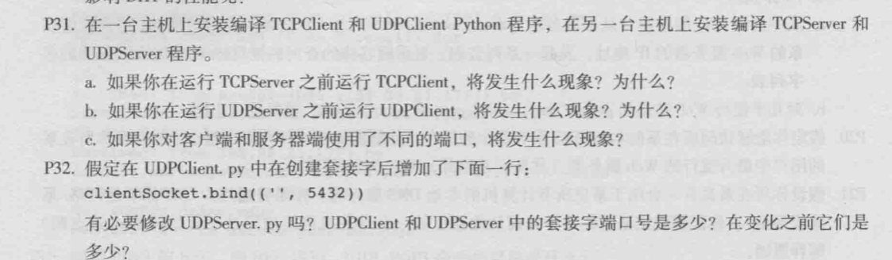
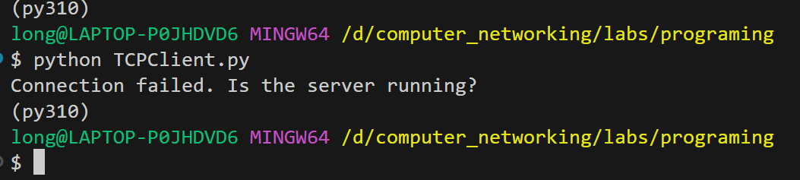
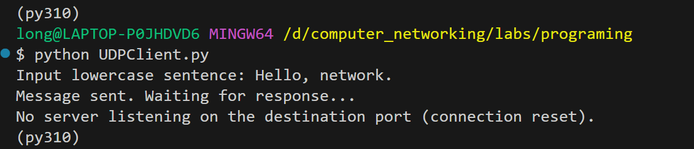
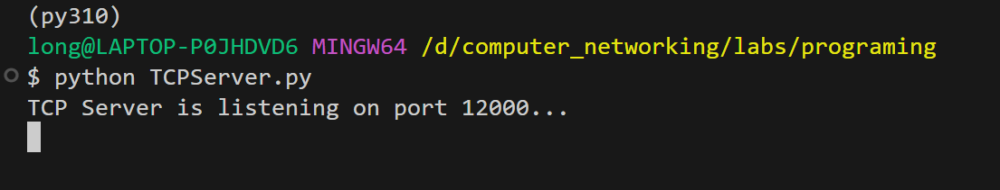
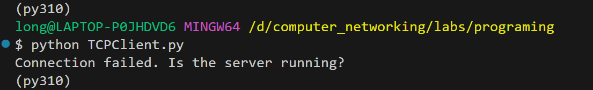
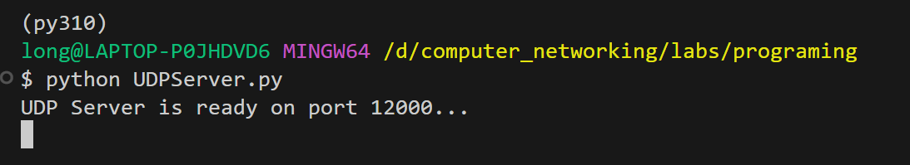
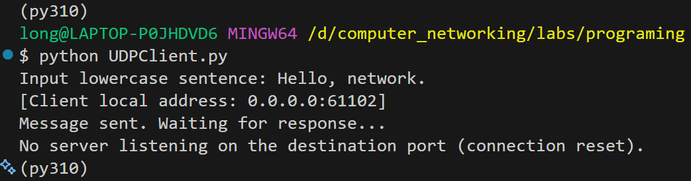
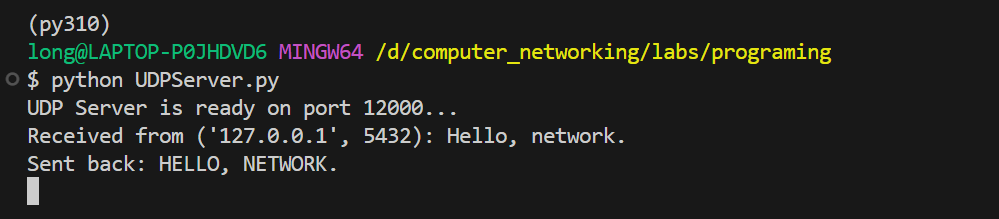
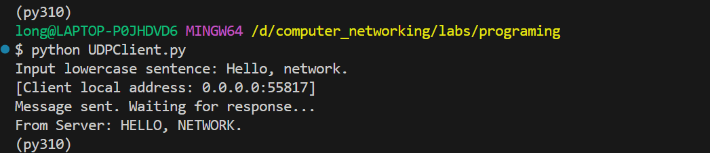
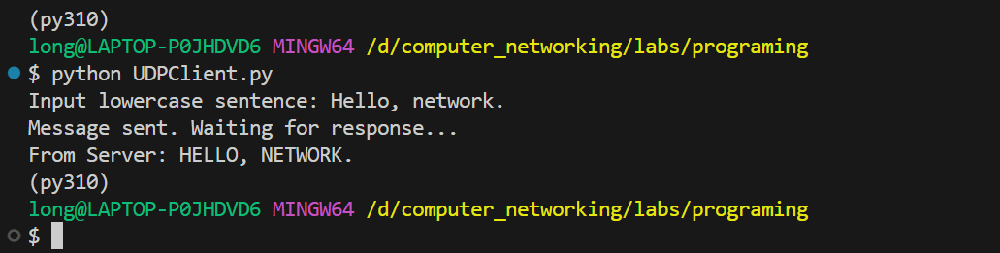

<h1 align="center">计网 Socket编程 实验报告</h1>

**实验名称：** TCP与UDP套接字编程实验
**实验环境：** Windows 11 单机模拟; 回环地址 `127.0.0.1`; Python 3.10
**实验日期：** 2026 年 5 月 13 日

---

## 1. 实验内容


---

## 2. 实验目的
1. 通过实验现象加深对 TCP 三次握手、UDP 不可靠传输等概念的认识
2. 理解端口号在传输层寻址中的作用，以及客户端显式绑定端口的含义。

---

## 3. 实验原理
- **TCP（传输控制协议）：** 面向连接的可靠传输协议。通信前需要通过三次握手建立连接，数据传输过程中有确认、重传、流量控制和拥塞控制机制，保证数据按序、无差错地到达。
- **UDP（用户数据报协议）：** 无连接的不可靠传输协议。发送方只负责将数据报发送到网络上，不保证对端能够收到，也不保证顺序，没有拥塞控制，应用层需要自行处理可靠性问题。
- **特殊 IP 地址和端口**: 
    - 回环地址 `127.0.0.1`：数据包不会离开本机协议栈，用于本机进程间网络通信测试。
    - `0.0.0.0 (INADDR_ANY)`：服务器绑定此地址表示监听本机所有可用网络接口。
    - 临时端口：客户端未绑定时，操作系统从动态端口范围（通常 49152–65535）自动分配。

---


## 4. 实验步骤

### 4.1 Python 源文件准备
见[附录](#附录程序源代码)

---

### 4.2 P1.a：先运行 `TCPClient` 后运行 `TCPServer`
在**终端执行**
```bash
python TCPClient.py
```

**观察现象：**
客户端立即输出 `Connection failed. Is the server running?`，程序退出。


终端显示 TCPClient 输出 `Connection failed`

**分析：**
TCP 客户端调用 `connect()` 时会向目标主机（127.0.0.1:12000）发送 SYN 报文，试图进行三次握手。由于端口 12000 上没有进程监听，本机协议栈收到 SYN 后直接回复 RST（复位）报文，而不是生成 ACK，导致 `connect()` 抛出 `ConnectionRefusedError`。这说明 TCP 是面向连接的，必须存在监听方才能建立连接。

---

### 4.3 P1.b：先运行 `UDPClient` 后运行 `UDPServer`

**终端执行**
```bash
python UDPClient.py
```

**观察现象：**
客户端输出：


**分析：**
UDP 是无连接的，`sendto()` 仅将数据报交给协议栈并立即返回，不检查目标是否有接收者。数据报发出后，本机协议栈发现 12000 端口无进程绑定，生成 ICMP 端口不可达报文。在 Windows 中，该 ICMP 错误被转换为 `ConnectionResetError` 并抛给 `recvfrom()`，因此客户端并未超时，而是捕获到连接重置异常。

UDP 的“发送成功”并不代表数据已经送达，体现了其不可靠的特性。

---

### 4.4 P1.c：客户端与服务器使用不同端口

#### 4.4.1 TCP 场景
1. 修改 `TCPClient.py`，将 `serverPort` 改为 `12001`（与服务器监听的 12000 不同）。
2. 运行 `python TCPServer.py`，终端显示服务器正在监听。
3. 另开终端运行 `python TCPClient.py`。

**观察现象：**



客户端仍然输出 `Connection failed. Is the server running?`，服务器则一直阻塞在 `accept()`，未收到任何连接。

**分析：**
客户端向 `127.0.0.1:12001` 发起连接，但没有任何进程在该端口监听，协议栈返回 RST，连接失败。端口号是传输层区分不同服务的关键标识，必须严格匹配。

#### 4.4.2 UDP 场景
1. 修改 `UDPClient.py`，将 `serverPort` 改为 `12001`。
2. 运行 `python UDPServer.py`，终端显示服务器就绪。
3. 另开终端运行 `python UDPClient.py`，输入消息。

**观察现象：**



客户端输出 `No server listening on the destination port (connection reset).`  
服务器终端没有任何接收输出，仍阻塞在 `recvfrom()`。

**分析：**
UDP 数据报被发往端口 `12001`，该端口无绑定套接字，系统丢弃数据报并返回 ICMP 端口不可达。服务器绑定在 12000，因此永远收不到这些数据。再次证明端口号在 UDP 中同样是数据分发的核心依据。

---

### 4.5 P2：UDP 客户端显式绑定固定端口

#### 4.5.1 未修改 UDPClient.py 的现象(没有显式`bind`)
**操作步骤**
1. 在一个终端运行 `UDPServer.py`
   ```bash
   python UDPServer.py
   ```
2. 在另一个终端运行上述修改后的 `UDPClient.py`：
   ```bash
   python UDPClient.py
   ```
3. 输入消息，如 `test`，观察两个终端。

**服务器输出**


**客户端收到回复：**



#### 4.5.2 修改 UDPClient.py (显式 `bind`)
在创建套接字后、发送数据前，添加 `bind` 调用。同时保留前面的异常处理：
```python
...
clientSocket = socket(AF_INET, SOCK_DGRAM)

# --- added line ---
clientSocket.bind(('', 5432))
# -----------------

message = input("Input lowercase sentence: ")
clientSocket.sendto(message.encode(), (serverName, serverPort))
print("Message sent. Waiting for response...")
...
```

**操作步骤**
1. 在一个终端运行 `UDPServer.py`
   ```bash
   python UDPServer.py
   ```
2. 在另一个终端运行上述修改后的 `UDPClient.py`：
   ```bash
   python UDPClient.py
   ```
3. 输入消息，观察两个终端.

**服务器输出**


**客户端收到：**


**分析：**
- 客户端显式 `bind(('', 5432))` 后，源端口固定为 5432，而非系统动态分配。`getsockname()` 可以验证这一点。
- 服务器代码无需任何修改，因为它在 `recvfrom()` 中获取了客户端的 IP 和端口，并以此为目标回复，自适应客户端的任何端口。
- 若客户端未正常退出，再次运行会因端口 5432 已被占用而抛出 `OSError: [Errno 10048]`（Windows 下的地址占用错误），说明同一端口不能被两个套接字同时绑定。

**端口变化对比：**

| 套接字        | 未显式 bind                          | 显式 bind 后   |
|---------------|--------------------------------------|----------------|
| UDPClient     | 操作系统随机临时端口 55187      | 固定为 5432    |
| UDPServer     | 始终为 12000                         | 不变，12000    |

### 4.5.3 思考
> 问: 是否有必要修改`UDPServer.py` ?

**答:** 没有必要。 服务器在 recvfrom() 中会获取客户端的 IP 和端口，并以此作为 sendto() 的目标地址，自适应任何客户端端口。客户端固定源端口不会影响服务器的回复逻辑。

---
## 5. 实验总结
1. **TCP 面向连接的特性**：客户端必须先建立连接才能通信，服务器必须先监听端口，否则客户端 `connect()` 会收到 RST 包而失败。
2. **UDP 无连接的特性**：客户端可以直接发送数据，无论目标端口是否监听，`sendto()` 都会成功返回；但接收方不存在时，系统会返回 ICMP 端口不可达，在 Windows 上表现为 `ConnectionResetError`，在 Linux 上可能仅触发超时。
3. **端口号的寻址作用**：端口号是**传输层区分进程**的关键标识，客户端和服务器必须就目标端口达成一致，否则数据无法正确交付。
4. **客户端 bind 的意义**：客户端也可以显式绑定源端口，这在某些需要固定源端口的应用中可能有用，但通常由操作系统自动分配更为方便；服务器无需关心客户端的端口号，因为它总是从收到的数据包中提取源地址进行回复。

---

## 附录：程序源代码

**TCPServer.py**
```python
from socket import *

serverPort = 12000
serverSocket = socket(AF_INET, SOCK_STREAM)
serverSocket.bind(('', serverPort))
```
```python
serverSocket.listen(1)  # 将套接字设为被动监听模式，并指定“已完成连接队列”的最大长度为 1。
print(f"TCP Server is listening on port {serverPort}...")

# connectionSocket 是一个新的套接字对象，用于与客户端进行通信。clientAddress 是客户端的地址信息。
connectionSocket, clientAddress = serverSocket.accept()
print(f"Accepted connection from {clientAddress}")

message = connectionSocket.recv(1024).decode()
print(f"Received: {message}")
response = message.upper()
connectionSocket.send(response.encode())
print(f"Sent: {response}")

connectionSocket.close()
serverSocket.close()
```

**TCPClient.py**
```python
from socket import *   # Python 标准套接字库，里面封装了操作系统底层的 socket 系统调用。

serverName = '127.0.0.1'
serverPort = 12000

clientSocket = socket(AF_INET, SOCK_STREAM)
# AF_INET 表示使用 IPv4 地址，SOCK_STREAM 表示使用 TCP 协议。
# 使用面向连接的 TCP 协议

try:
    # 进行三次握手
    clientSocket.connect((serverName, serverPort))

    # 成功建立连接
    print("Connected to server.")
```
```python
    sentence = input("Input lowercase sentence: ")
    clientSocket.send(sentence.encode()) # 将字符串编码为字节串后发送给服务器

    modifiedSentence = clientSocket.recv(1024)  # 从服务器接收数据，参数 1024 表示一次最多接收 1024 字节
    print(f"From Server: {modifiedSentence.decode()}")

except ConnectionRefusedError as e:
    print(f"Connection failed. Is the server running ? [{e}]")
except Exception as e:
    print(f"An error occurred: {e}")
finally:
    clientSocket.close()
```

**UDPServer.py**
```python
from socket import *

serverPort = 12000
serverSocket = socket(AF_INET, SOCK_DGRAM)

serverSocket.bind(('', serverPort))  # 将套接字绑定到本地地址和端口，显示绑定到12000端口
print(f"UDP Server is ready on port {serverPort}...")
while True:
    message, clientAddress = serverSocket.recvfrom(2048) # recfrom能够直接返回客户端的地址信息
    # clientAddress 是一个元组，从报文获取客户端的 IP 地址和端口号。
    print(f"Received from {clientAddress}: {message.decode()}")

    response = message.decode().upper()

    serverSocket.sendto(response.encode(), clientAddress)
    print(f"Sent back: {response}")
```

**UDPClient.py（最终通用版，含临时端口查看）**
```python
from socket import *
import sys

serverName = '127.0.0.1'
serverPort = 12000
clientSocket = socket(AF_INET, SOCK_DGRAM)
# AF_INET 表示使用 IPv4 地址，SOCK_DGRAM 表示使用 UDP 协议。
# SOCK_DGRAM 使用无连接的 UDP 协议

# 显示 bind 指定的本地地址（IP 和临时端口）
# clientSocket.bind(('', 5432))

message = input("Input lowercase sentence: ")
# 直接发送数据报
clientSocket.sendto(message.encode(), (serverName, serverPort))


# 打印本地套接字, sendto已经隐式绑定了一个本地端口，所以可以获取到本地地址信息
# 未 bind 时是临时端口；显式 bind 后就是固定的 5432。
local_ip, local_port = clientSocket.getsockname()
print(f"[Client local address: {local_ip}:{local_port}]\nMessage sent. Waiting for response...")

clientSocket.settimeout(2) # 设置超时 2 秒，若没有数据报到达则抛出 timeout。
try:
    modifiedMessage, serverAddress = clientSocket.recvfrom(2048)
    print(f"From Server: {modifiedMessage.decode()}")
except timeout:
    print("No response from server (timeout).")
except ConnectionResetError:
    print("No server listening on the destination port (connection reset).")
    # windwo 中, 若UDP连接没有找到目标服务器，会向源主机回复 ICMP 报告, recvfrom会抛出 ConnectionResetError
except Exception as e:
    print(f"An error occurred: {e}")
finally:
    clientSocket.close()
```