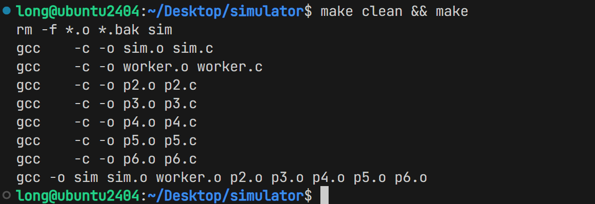
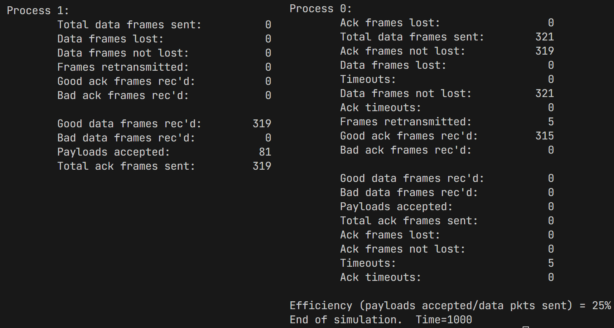

# 可靠数据传输（RDT）协议模拟实验报告

---

## 一、实验简介

本实验基于 一个协议模拟器，通过在可控的模拟环境下运行协议 2（停等协议）至协议 6（选择重传协议），观察不同可靠数据传输机制在丢包、校验和错误、超时等信道损伤条件下的行为表现，加深对可靠数据传输协议逐级演进的理解。

模拟器创建三个 UNIX 进程：一个主控进程（main）负责时钟推进与调度，两个工作进程（M0、M1）分别运行协议代码，通过管道通信模拟帧的收发。信道的丢包和比特差错由随机数模拟，超时由定时器机制驱动。

---

## 二、实验目的

1. 掌握停等协议（协议 2/3）、滑动窗口协议（协议 4）、Go-Back-N（协议 5）和选择重传（协议 6）的基本原理与区别
2. 理解序列号、确认号、定时器、NAK 等机制在可靠数据传输中的作用
3. 定性/定量分析超时间隔（timeout）、丢包率（pkt_loss）和校验和错误率（cksum_err）对协议性能（效率、重传次数）的影响
4. 比较 Go-Back-N 与 Selective Repeat 在不同信道条件下的优劣
5. 探索事件优先级、最优超时设置、时钟推进策略和可变传输时延对协议行为的影响

---

## 三、实验环境

| 项目 | 说明 |
|:----:|:-----|
| 操作系统 | Ubuntu 24.04 (64-bit) |
| 编译器 | gcc（通过 `sudo apt install build-essential` 安装） |
| 模拟器源码 | 实验提供的 sim 模拟器 |
| 源码文件 | `sim.c`、`worker.c`、`p1.c`~`p6.c`、`common.h`、`protocol.h` |
| 可执行文件 | `./sim` |

---

## 四、实验原理

### 4.1 模拟器架构

**模拟器由三个进程组成，通过 6 根管道实现两两通信：**

- **main** 使用 `rand() & 1` 随机选择一个工作进程，写入当前 tick 值作为放行信号
- 工作进程接收当前时间后调用 `pick_event()` 选择可行事件，返回给协议函数处理
- 连续 DEADLOCK（= 3×timeout_interval）个 tick 双方均无事可做，判定死锁

**信道的三种损伤通过随机数模拟：**

| 损伤 | 实现方式 | 参数 |
|------|----------|------|
| 丢帧 | `to_physical_layer()` 中，以概率 `pkt_loss/1024` 直接丢弃，不写入管道 | 命令行参数 pct_loss (0-99) |
| 校验和错误 | `frametype()` 中，帧出队时以概率 `garbled/1024` 标记为 `cksum_err` | 命令行参数 pct_cksum (0-99) |
| 超时 | `check_timers()` 检查定时器是否到期 | 命令行参数 timeout (tick 数) |

### 4.2 六种协议的演化

六个协议构成一条逐步演化的设计链，每个协议在前一个基础上增加新能力，解决一个现实问题：
| 协议 | 要解决的问题 | 引入的机制 | MAX_SEQ | 窗口 | 事件类型 |
|:----:|-------------|-----------|:-------:|:----:|----------|
| 1 | 最基础的帧传输（理论基准） | 发帧、收帧、递交网络层 | — | — | frame_arrival |
| 2 | 接收方处理速度有限 → **流控** | 哑帧确认，发后等待 | 无序号 | 1 | frame_arrival |
| 3 | 信道不可靠（丢帧、损坏）→ **差错控制** | 序号+确认号+定时器+超时重传 | 1 | 1 | +cksum_err, timeout |
| 4 | 单向浪费反向信道 → **双向利用** | 双向通信 + 捎带确认(Piggybacking) | 1 | 1 | 同协议3 |
| 5 | 停等信道利用率低 → **流水线** | 滑动窗口+回退N帧(GBN)+累积确认 | 7 | 7 | +network_layer_ready |
| 6 | GBN全部重传浪费带宽 → **精确重传** | 选择重传+乱序缓存+NAK+独立定时器+延迟确认 | 7 | 4 | +ack_timeout |

> 协议 1→3 解决**可靠性**问题（从"假设完美"到"应对不完美"），协议 4 解决**双向利用**问题，协议 5→6 解决**效率**问题（从"停等"到"流水线"再到"精确重传"）。

---

## 五、实验内容与步骤

### 5.1 编译与基本使用

**编译**

```bash
cd /home/long/Desktop/simulator
make
```

> **【放置截图 1】**：此处放置 `make` 编译成功后的终端截图。



**运行格式**

```bash
./sim <protocol> <events> <timeout> <pct_loss> <pct_cksum> <debug_flags>
```

| 参数位置 | 参数名 | 含义 | 示例值 |
|:--------:|--------|------|:------:|
| 1 | protocol | 协议编号 | 2~6 |
| 2 | events | 仿真事件总数 | 10000 |
| 3 | timeout | 超时间隔 (tick) | 50 |
| 4 | pct_loss | 丢包百分比 (0-99) | 20 |
| 5 | pct_cksum | 校验和错误百分比 (0-99) | 10 |
| 6 | debug_flags | 调试标志：1=发送 2=接收 4=超时 8=周期输出 | 0 (静默) |

**验证运行**

```bash
# 随便跑一个检验运行
./sim 3 1000 10 0 0 3
```

> **【放置截图 2】**：此处放置验证命令的运行输出截图，显示统计信息正常输出。



---

### 5.2 Exercises 1 — 单协议性能分析

> **【实验者指引】** 选择一个协议（建议协议 5 或 6），固定 events=100000, debug_flags=0，分别扫描 timeout、pct_loss、pct_cksum 三个参数。每个参数变化时，另两个固定。运行每条命令后记录输出的效率值（Efficiency = payloads accepted / data pkts sent）。将数据填入 `数据记录-选题1.md` 文件。然后根据该数据文件用 Excel 或 Python 生成三张折线图（x轴=变化参数，y轴=Efficiency%）。

#### A. 扫描 timeout（固定 pct_loss=10, pct_cksum=10）

选择协议: ___5___

```bash
./sim 5 100000 10 10 10 0
./sim 5 100000 20 10 10 0
./sim 5 100000 40 10 10 0
./sim 5 100000 80 10 10 0
./sim 5 100000 160 10 10 0
```

> **【放置图表 1】**：此处放置 "Efficiency vs 超时间隔" 折线图（x轴=timeout tick值，y轴=效率%）。

#### B. 扫描 pct_loss（固定 timeout=50, pct_cksum=10）

```bash
./sim <协议号> 100000 50 0 10 0
./sim <协议号> 100000 50 10 10 0
./sim <协议号> 100000 50 20 10 0
./sim <协议号> 100000 50 30 10 0
./sim <协议号> 100000 50 50 10 0
```

> **【放置图表 2】**：此处放置 "Efficiency vs 丢包率" 折线图（x轴=丢包率%，y轴=效率%）。

#### C. 扫描 pct_cksum（固定 timeout=50, pct_loss=10）

```bash
./sim <协议号> 100000 50 10 0 0
./sim <协议号> 100000 50 10 10 0
./sim <协议号> 100000 50 10 20 0
./sim <协议号> 100000 50 10 30 0
./sim <协议号> 100000 50 10 50 0
```

> **【放置图表 3】**：此处放置 "Efficiency vs 校验和错误率" 折线图（x轴=校验错%，y轴=效率%）。

**分析要点（待填写）**：_______

---

### 5.3 Exercises 2 — GBN vs SR 对比实验

> **【实验者指引】** 对协议 5（GBN）和协议 6（SR）在相同参数下分别运行，记录效率（Efficiency%）和重传次数（data_retransmitted，需要 debug_flags 带输出或从统计输出中获取）。将数据填入 `数据记录-选题2.md` 文件。生成一张对比柱状图/折线图。

**固定 events=50000, debug_flags=0（如需重传数则先跑一次 debug_flags=0 看最终输出）**

| timeout | pct_loss | pct_cksum | 协议 5 效率 | 协议 5 重传 | 协议 6 效率 | 协议 6 重传 |
|:-------:|:--------:|:---------:|------------|------------|------------|------------|
| 10 | 10 | 10 | | | | |
| 50 | 10 | 10 | | | | |
| 200 | 10 | 10 | | | | |
| 10 | 30 | 10 | | | | |
| 50 | 30 | 10 | | | | |
| 200 | 30 | 10 | | | | |
| 10 | 30 | 30 | | | | |
| 50 | 30 | 30 | | | | |
| 200 | 30 | 30 | | | | |

运行命令示例：
```bash
# 低差错
./sim 5 50000 10 10 10 0
./sim 6 50000 10 10 10 0
# 高丢包
./sim 5 50000 50 30 10 0
./sim 6 50000 50 30 10 0
# 恶劣信道
./sim 5 50000 50 30 30 0
./sim 6 50000 50 30 30 0
```

> **【放置图表 3】**：此处放置 "GBN vs SR 效率对比" 图表（建议按不同信道条件分组对比柱状图，x轴=信道条件组，y轴=效率%，两组柱子分别代表 GBN 和 SR）。

> **【放置图表 5】**：此处放置 "GBN vs SR 重传次数对比" 图表。

**分析要点（待填写）**：_______

---

### 5.4 Exercises  3 — 事件优先级实验

> **【实验者指引】** 修改 `worker.c` 中 `pick_event()` 函数的事件检测顺序。以协议 5 为例，默认顺序是：`nframes > 0`（帧到达/校验错）→ `network_layer_status`（网络层就绪）→ `check_timers()`（超时）。尝试将 `check_timers()` 的检测提前到第一条，即让 timeout 优先于 frame_arrival。重新编译后运行对比。将结果填入 `数据记录-选题3.md`。

**修改方法：**

在 `worker.c` 的 `pick_event()` 函数中，找到协议 5 的 case：

```c
    case 5:
        if (nframes > 0) return((int)frametype());        // 原：帧到达优先
        if (network_layer_status) return(network_layer_ready);
        if (check_timers() >= 0) return(timeout);
        return(NO_EVENT);
```

修改为：

```c
    case 5:
        if (check_timers() >= 0) return(timeout);          // 改：超时优先
        if (nframes > 0) return((int)frametype());
        if (network_layer_status) return(network_layer_ready);
        return(NO_EVENT);
```

**对比测试命令（每组跑 5 次取平均）：**

```bash
# 修改前 — 帧到达优先
make && ./sim 5 10000 50 20 10 3
# 修改后 — 超时优先
make && ./sim 5 10000 50 20 10 3
```

> **【放置截图 3】**：此处放置修改前后 `worker.c` 中 `pick_event()` 函数的代码对比截图。

> **【放置数据表格 1】**：此处放置修改前后多次运行的效率、重传次数、超时次数对比表。

**分析要点（待填写）**：_______

---

### 5.5 Exercises  4 — 最优超时间隔研究

> **【实验者指引】** 选择一个协议（建议协议 5 或 6），在固定的丢包率和校验错下，系统性地变化 timeout 值（建议从 5 到 200，以 5 为步长），记录每次运行的重传帧数量（data_retransmitted）。找到使重传次数最小的 timeout 区间。将数据填入 `数据记录-选题4.md`。

**固定参数**：events=50000, pct_loss=20, pct_cksum=10, debug_flags=0

**运行命令（timeout 从 5 到 200，步长 5，共 40 个数据点）：**

```bash
# 协议 5
for t in 5 10 15 20 25 30 35 40 45 50 55 60 65 70 75 80 85 90 95 100 110 120 130 140 150 160 170 180 190 200; do
  echo "=== timeout=$t ===" >> 选题4_p5.txt
  ./sim 5 50000 $t 20 10 0 >> 选题4_p5.txt
done

# 协议 6
for t in 5 10 15 20 25 30 35 40 45 50 55 60 65 70 75 80 85 90 95 100 110 120 130 140 150 160 170 180 190 200; do
  echo "=== timeout=$t ===" >> 选题4_p6.txt
  ./sim 6 50000 $t 20 10 0 >> 选题4_p6.txt
done
```

> **【放置图表 6】**：此处放置 "重传次数 vs 超时间隔" 折线图（x轴=timeout，y轴=重传次数，可两条线分别代表 GBN 和 SR）。

> **【放置图表 7】**：此处放置 "效率 vs 超时间隔" 折线图（同上，y轴改为效率%）。

**分析要点（待填写）**：_______

---

### 5.6 Exercises  5 — 优化时钟推进策略

> **【实验者指引】** 当前模拟器在 main loop 中每次 tick += DELTA(10)，即使两个进程都阻塞在较远的超时上也慢慢爬。修改 `sim.c` 中的主循环，使得当 `lowest_timer` 远大于当前 tick 时，直接跳到 `lowest_timer`。对比修改前后在大超时间隔下的运行时间差异。

**修改思路：**

当前 `sim.c` 主循环（约第 70-85 行）每次 `tick += DELTA`。优化方向：
- 在 main 进程中追踪两个 worker 的 `lowest_timer`（或通过管道获取）
- 当 `tick < min_lowest_timer` 时，一次跳到 `min_lowest_timer`

> **注意**：这是进阶修改，需要理解 worker 如何向 main 报告状态。可以先尝试简单方案：在 main 中如果连续多次收到 NOTHING，且 tick 离最低定时器还有距离，则跳跃推进。

**对比测试：**

```bash
# 修改前：大 timeout，观察模拟运行时长
time ./sim 5 50000 500 10 10 0
# 修改后
time ./sim 5 50000 500 10 10 0
```

> **【放置截图 4】**：此处放置修改前后 `sim.c` 主循环的代码对比截图。

> **【放置数据表格 2】**：此处放置修改前后不同 timeout 下的模拟运行时间对比（使用 `time` 命令）。

**分析要点（待填写）**：_______

---

### 5.7 Exercises  6 — 引入可变传输时延

> **【实验者指引】** 当前模拟器中，帧一旦写入管道就算"瞬时到达"。修改模拟器使得每个帧携带随机延迟，接收方在该延迟后才处理。需要修改 `worker.c` 中的帧投递逻辑，以及可能增加管道中的延迟标记。观察延迟方差对协议性能的影响。

**修改思路：**
- 在 frame 结构或管道传递时增加一个 delay 字段
- 在 `queue_frames()` 或 `frametype()` 中加入延迟判断逻辑
- 添加用户可设置的方差参数（如新增命令行参数）

**对比测试（修改后）：**

```bash
# 不同方差下的协议性能对比
# 方差=0（基准）
./sim 5 50000 50 10 10 0
# 方差=小
./sim 5 50000 50 10 10 0 --variance 5
# 方差=大
./sim 5 50000 50 10 10 0 --variance 50
```

> **【放置截图 5】**：此处放置修改后的关键代码片段截图。

> **【放置图表 8】**：此处放置 "效率/重传次数 vs 传输时延方差" 图表。

**分析要点（待填写）**：_______

---

## 六、实验结果汇总与分析

> **【实验者指引】** 本部分在所有实验数据收集完毕后一并填写。将各选题的数据和图表汇总此处，给出综合分析。

### 6.1 选题 1 结果分析

（填写对单协议性能扫描的分析结论）

### 6.2 选题 2 结果分析

（填写 GBN vs SR 对比分析的结论）

### 6.3 选题 3 结果分析

（填写事件优先级实验的结论）

### 6.4 选题 4 结果分析

（填写最优超时间隔研究的结论）

### 6.5 选题 5 结果分析

（填写时钟优化实验的结论）

### 6.6 选题 6 结果分析

（填写可变时延实验的结论）

---

## 七、实验总结

> **【实验者指引】** 写下本次实验的整体收获和思考。

（从以下几个方面展开：）
1. 超时、丢包、校验错三个关键因素对协议性能的影响规律
2. 模拟器方法的局限性和与实际网络的差异
3. 实验过程中遇到的问题与解决方案

---

## 附录：数据文件索引

| 文件名 | 对应选题 | 说明 |
|--------|----------|------|
| `数据记录-选题1.md` | 选题 1 | 单协议性能扫描数据（timeout/丢包/校验错 vs 效率） |
| `数据记录-选题2.md` | 选题 2 | GBN vs SR 对比数据（效率+重传） |
| `数据记录-选题3.md` | 选题 3 | 事件优先级修改前后对比数据 |
| `数据记录-选题4.md` | 选题 4 | 最优超时扫描数据 |
| `数据记录-选题5.md` | 选题 5 | 时钟优化对比数据 |
| `数据记录-选题6.md` | 选题 6 | 可变时延实验数据 |

---

## 附录：图表与截图清单

| 编号 | 内容 | 类型 | 对应位置 |
|------|------|------|----------|
| 截图 1 | make 编译成功 | 截图 | 5.1 节 |
| 截图 2 | 验证运行输出 | 截图 | 5.1 节 |
| 图表 1 | Efficiency vs 超时间隔（选题1-A） | 折线图 | 5.2 节 |
| 图表 2 | Efficiency vs 丢包率（选题1-B） | 折线图 | 5.2 节 |
| 图表 3 | Efficiency vs 校验错率（选题1-C） | 折线图 | 5.2 节 |
| 图表 4 | GBN vs SR 效率对比（选题2） | 柱状图 | 5.3 节 |
| 图表 5 | GBN vs SR 重传对比（选题2） | 柱状图 | 5.3 节 |
| 截图 3 | pick_event 修改前后代码对比（选题3） | 截图 | 5.4 节 |
| 数据表格 1 | 事件优先级对比数据（选题3） | 表格 | 5.4 节 |
| 图表 6 | 重传次数 vs 超时间隔（选题4） | 折线图 | 5.5 节 |
| 图表 7 | 效率 vs 超时间隔（选题4） | 折线图 | 5.5 节 |
| 截图 4 | 时钟优化代码对比（选题5） | 截图 | 5.6 节 |
| 数据表格 2 | 时钟优化运行时间对比（选题5） | 表格 | 5.6 节 |
| 截图 5 | 可变时延代码修改（选题6） | 截图 | 5.7 节 |
| 图表 8 | 效率/重传 vs 时延方差（选题6） | 折线图/柱状图 | 5.7 节 |