<!-- 封面页 -->
<div style="font-family: 'Microsoft YaHei', 'SimHei', sans-serif; background:#ffffff; width:90%; max-width:800px; margin:0 auto; padding:80px 40px; min-height:700px;">
  <h1 style="text-align:center; font-size:32px; font-weight: bold; margin:0 0 60px 0;">《计算机系统》</h1>
  <h2 style="text-align:center; font-size:28px; font-weight: bold; margin:0 0 180px 0;">原型机 vspm1.0 实验报告</h2>
  <div style="font-size:20px; text-align:center; line-height:2.2; font-weight: normal;">
    <div>班级：智能科学与技术专业</div>
  </div>
</div>

<!-- 目录页（极简版） -->
<div style="font-family: 'Microsoft YaHei', 'SimHei', sans-serif; background:#ffffff; width:90%; max-width:800px; margin:40px auto; padding:40px 15; min-height:700px;">
  <h2 style="text-align:center; font-size:26px; font-weight: bold; margin-bottom:40px;">目录</h2>
  <div style="font-size:20px; line-height:2;">
    <div style="margin:6px 0; font-weight: bold;">1 实验项目一</div>
    <div style="margin:6px 0; padding-left:32px; font-weight: bold;">1.1 项目名称</div>
    <div style="margin:6px 0; padding-left:32px; font-weight: bold;">1.2 实验目的</div>
    <div style="margin:6px 0; padding-left:32px; font-weight: bold;">1.3 实验资源</div>
    <div style="margin:6px 0; font-weight: bold;">2 实验任务</div>
    <div style="margin:6px 0; padding-left:32px; font-weight: bold;">2.1 实验任务A</div>
    <div style="margin:6px 0; padding-left:32px; font-weight: bold;">2.2 实验任务B</div>
    <div style="margin:6px 0; padding-left:32px; font-weight: bold;">2.3 实验任务C</div>
    <div style="margin:6px 0; font-weight: bold;">3 总结</div>
    <div style="margin:6px 0; padding-left:32px; font-weight: bold;">3.1 实验中出现的问题</div>
    <div style="margin:6px 0; padding-left:32px; font-weight: bold;">3.2 心得体会</div>
    <div style="margin:6px 0; font-weight: bold;">4 思考</div>
    <div style="margin:6px 0; padding-left:32px; font-weight: bold;">4.1 思考一</div>
    <div style="margin:6px 0; padding-left:32px; font-weight: bold;">4.2 思考二</div>
    <div style="margin:6px 0; padding-left:32px; font-weight: bold;">4.3 思考三</div>
    <div style="margin:6px 0; padding-left:32px; font-weight: bold;">4.4 思考四</div>
  </div>
</div>

### 1 实验项目一
#### 1.1 项目名称
原型机 vspm1.0

#### 1.2 实验目的
- 了解冯诺依曼体系结构
- 理解指令集结构及其作用
- 理解计算机的运行过程, 就是指令的执行过程, 并初步掌握调试方法

#### 1.3 实验资源
1. VMware17 构建虚拟机并安装Ubuntu24.04 桌面版
2. 课程网站: **`vspm.jar`和`vspm`文件**用于Linux运行非常简易原型机模拟器
4. 实验一所需的汇编指令文件: `a-inst.txt`, `b-inst.txt`, `c-inst.txt`
5. 课程网站阅读文件: `最小系统与原型机.docx`

### 2 实验任务
#### 2.1 实验任务 A
**任务名称**: 跟着文档使用`vspm`运行`a-inst.txt`
```txt
6
in R1  	#输入a到R1
movi 1 	#设置R0为1
add R2,R1 	#R2存放累加值
sub R1,R0	#R1的值即a减去1,此时会设置Ｇ值
movd		#将当前PC值保存在R3中
movi -3	#存放-3到R0中,跳转到第二行
add R3,R0	#R3减去3，注意此时不能用SUB指令，会影响G值
jg		#如果R1的值还大于1，则跳到第2行去执行
out R2		#如果R1的值此时小于等于1，则准备输出
halt		#停机
```

##### (1) 运行 ./vspm <汇编文件>
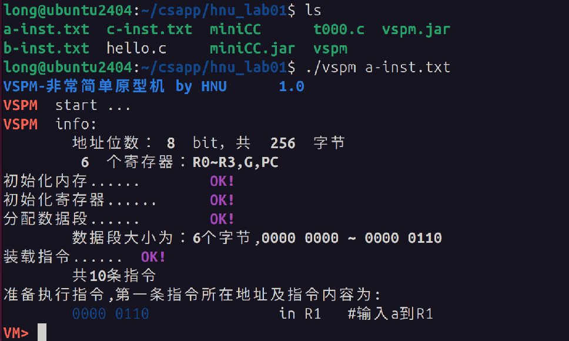
首先分配6个字节的数据段, 程序计数器PC的值为`0x6`, 即将要执行`in R1` 

##### (2) si (N) 执行一条或N条
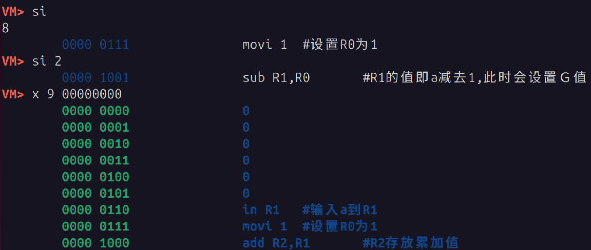
 
##### (3) i r 查看寄存器
执行`SUB R1 R0`之后, `G`的状态变为`1`,  `R1`存减法的结果`7`
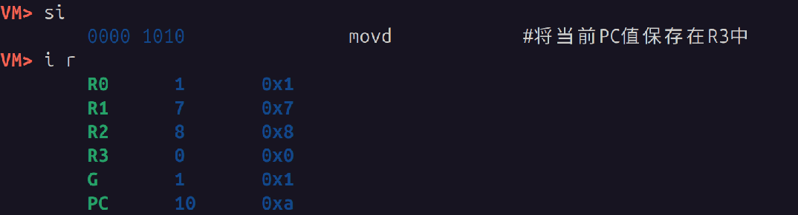

##### (4) c 连续执行到程序结束
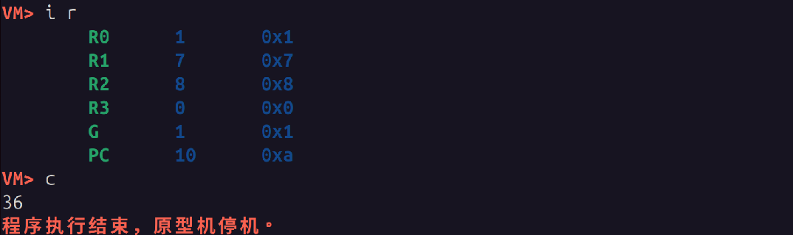


#### 2.2 实验任务 B
**任务名称**: 运行并解释`b-inst.txt`

`b-inst.txt`该汇编文件实现了**输入两个数, 打印出较小值**的程序作用
```txt
6
in R1 		#输入第一个数a
in R2 		#输入第二个数b
mova R0,R1 	#在R0保存a 
sub R1,R2  	#a-b,此时会设置G
mova R1,R0 	#a保存到R1
movd       	#保存当前的PC值到R3
movi 6     	#R0的值设置为6,即跳转到11行
add R3,R0  	#R3的值加6
mova R0,R2 	#b的值保存到R0
jg         	#如果a的值比b大,就跳转
#跳转地址
mova R0,R1 #将a的值保存到R0
out R0     #输出R0
halt
```
##### (1) 输入待比较的两个值
执行`si 2`, 即`in R1`和`in R2`
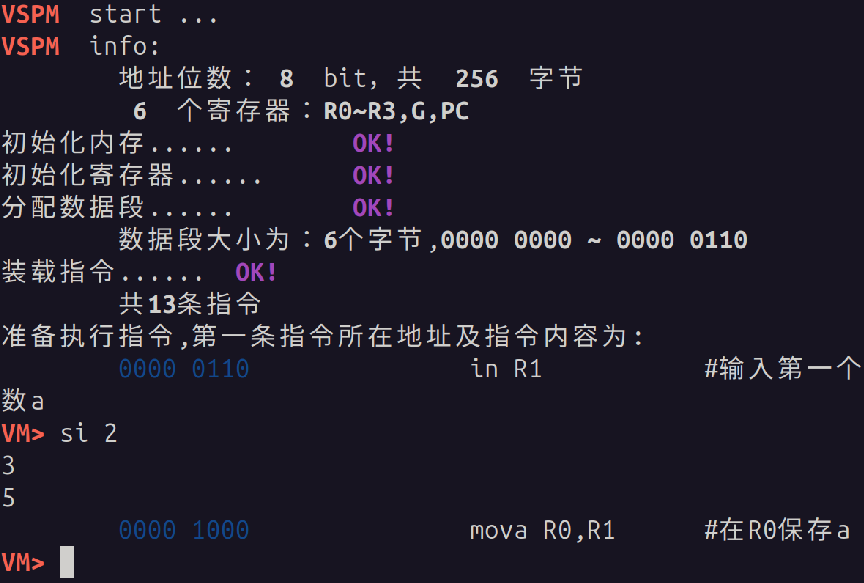
分别输入`3 5`

##### (2) 利用`SUB`进行比较
依次单步执行, 利用sub运算产生的状态位`G`记录大小比较结果, 此时寄存器各值如图.
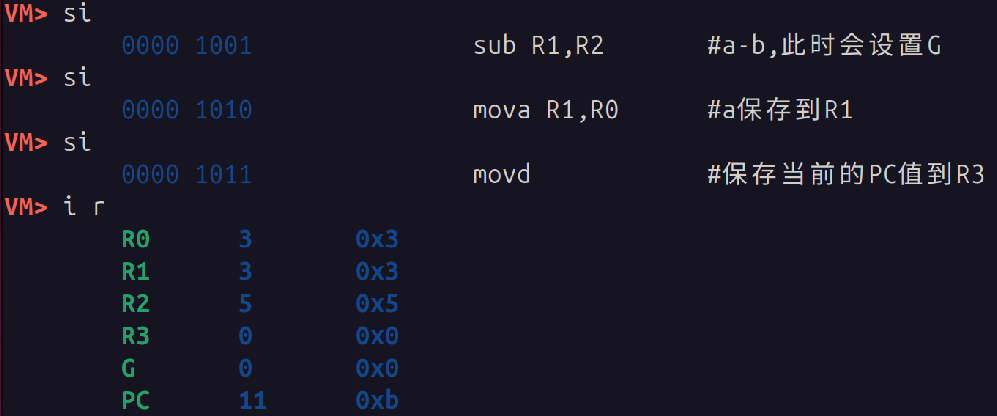

##### (3) 输出较小值
最终都从`R0`输出那个最小值, 在`jg`之前, 先`mova R0,R2`, 把b的值保存到`R0`:
1. **a比b小**, 不跳转, 紧接着执行`mova R0,R1`, 将a的值保存到`R0`, 并输出.
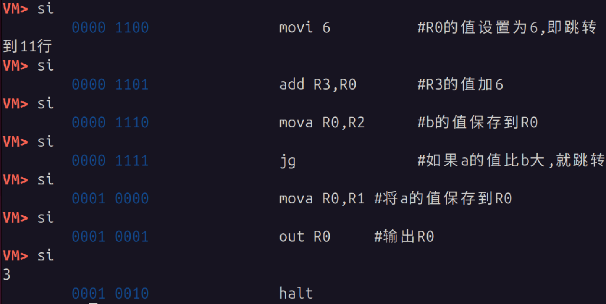

2. **a比b大**, `G`=1, 会执行`jg`, 根据`R3`的地址进行跳转, 直接跳转到`0001 0001`,输出`R0`的值, 即`b`的值
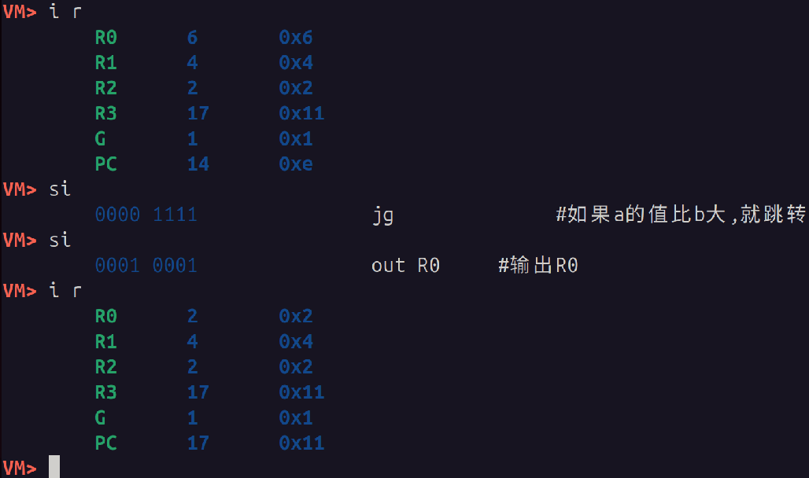

#### 2.3 实验任务 C
**任务名称**: 运行并解释`c-inst.txt`

`c-inst.txt`能够实现两个数相乘
```text
8
#两个大于1的正数相乘
in R1		#乘数a
movb R0,R1	#乘数a存放到内存0000 0000
in R1		#被乘数b
movi 1
movb R0,R1	#被乘数b存放在内存0000 0001
		#结果存放在内存 0000 0010
#开始循环
movi 1		#R0中的值为1
movc R1,R0	#从内存中取出值b
movi 1		#设置R0中的值为1
sub R1,R0	#R1即b值减1，此时设置G值
movi 1
movb R0,R1	#b值需要保存回去
movi 0		#R0中设置为0，即内存地址0
movc R2,R0	#取出a值
movi 2		#R0中设置为2，即内存地址0000 0010
movc R1,R0	#取出结果
add R1,R2	#做加法
movb R0,R1	#将结果存回去
movd       	#保存当前的PC值到R3
movi -12     	#R0的值设置为-12
add R3,R0  	#R3的值加-12
jg         	#如果第12行的减法设置G为1,就跳转
#循环结束
movi 2		#R0中设置为2，即内存地址0000 0010
movc R1,R0	#取出结果
out R1		#打印结果
halt
```

#### (1) 输入两数并放在内存
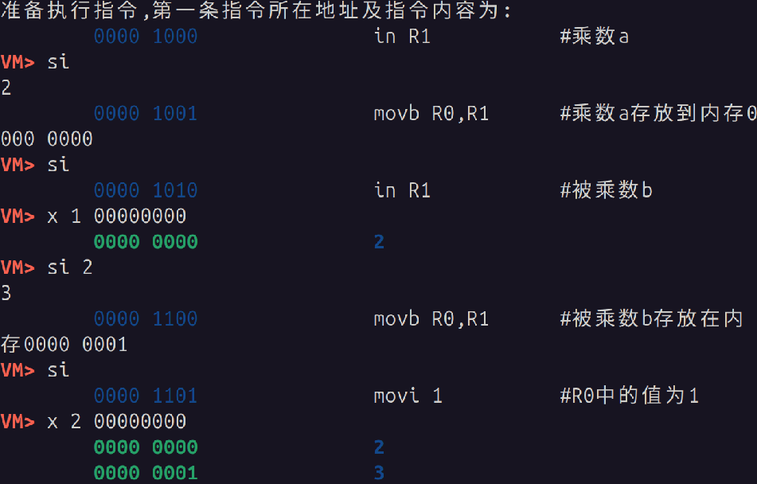

#### (2) b减1, 结果加上1*a
b从内存取出来, 减1后在放回去, 同时用`G`记录b是否大于1: `G`=1表明`b>1`
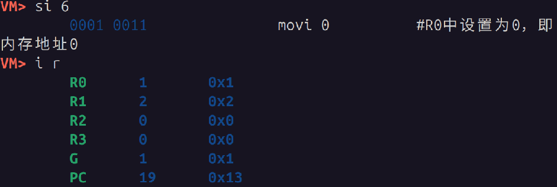
之后在从地址`00000010`中取出结果, 加上一个`a`, 在放回内存
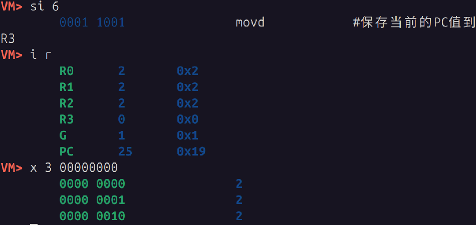
#### (3) 判断是否结束循环
先设置`R3`的值为循环起点, 咱根据`G`的值判断当前b值是否为0, 如果为0就不跳转, 直接循环结束
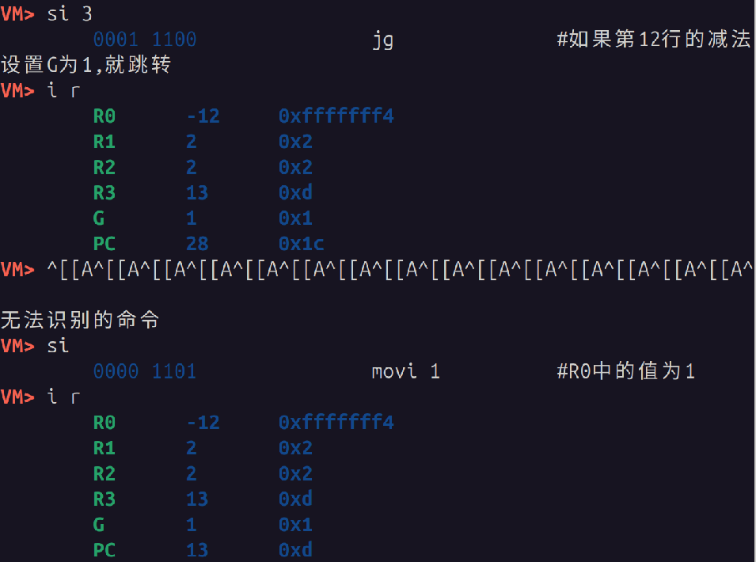
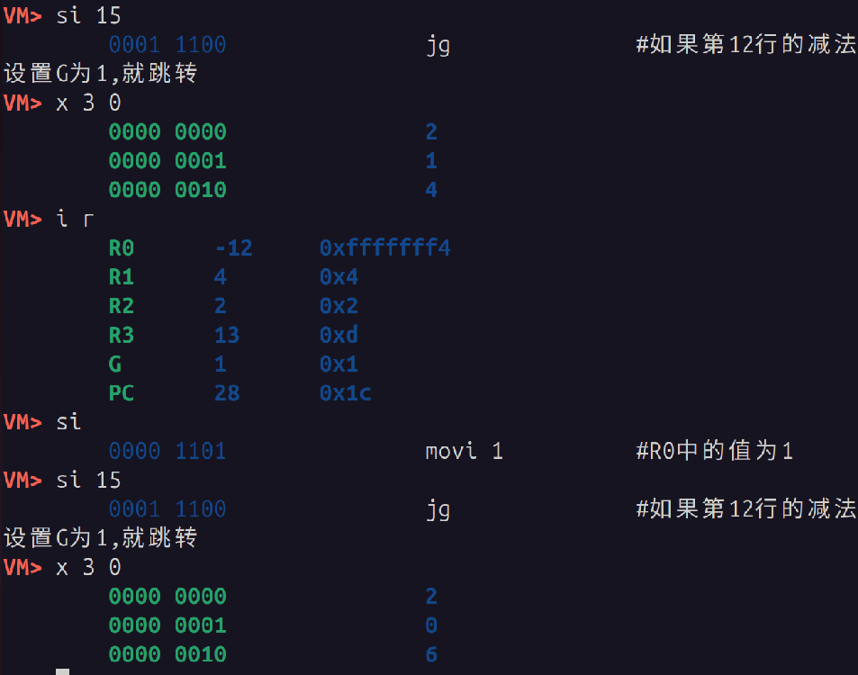
#### (4) 循环结束,从内存取结果打印
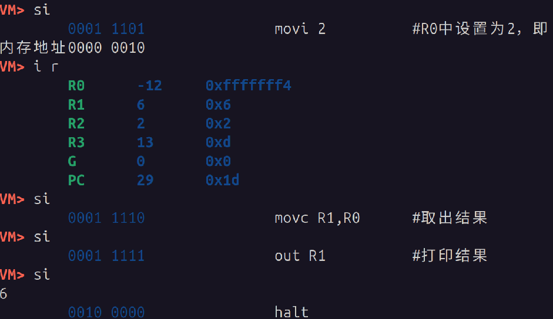


### 3 总结
#### 3.1 实验中出现的问题
1. 在终端开始运行`./vspm <文件>`时, 遇到了`java: command not found`的提示, 得知需要配置Java环境, 选择安装`JDK-8`来实现`vspm.jar`的正常运行

#### 3.2 新的体会
1. 该实验与上学期的核心课数电的**模型机**大实验遥相呼应, 以命令行程序的形式再次了解了模型机的结构, 感受到**他对冯诺依曼体系结构的体现**;
2. 通过vspm这一原型机的模拟器, 更加能够洞察计算机运行时指令的执行过程
3. 关于汇编程序, 感受到了他与**高级语言程序的不同**

### 4 问题思考

#### 4.1 如何基于这些指令实现两个整数的乘法和除法 ?** 
##### 1.**乘法**
乘法可以用`c-inst.txt`的思路, 进行**加法累加实现相乘的效果**, 每次循环将其中一个乘数减一, 循环截止条件是被减的数变为0(`jg`来判断)

##### 2.**除法**
可以通过**减法计数**的思路实现, `a ÷ b`可以看作是`a`中能减去多少个`b`, 商就是能减多少个, 余数就是a剩余属于的减不动的.
依旧可以用循环实现, 用内存记录商从零到结果, 每次循环a要减一个b, 循环结束的标记就是a剩余值小于b

vspm1.0汇编实现
```text
8
############### two int divide
######## a -> -a if a < 0
in R1
movi 0
movb R0,R1 # store original a at 0
sub R0,R1
mova R1,R0
movi 2
movd
movi 10
add R3,R0
jg  # jump if original a < 0 
movi 2
movc R1,R0
add R1,R0
movb R0,R1
movi 0
movc R1,R0 # load original a
######## a -> -a

######## b -> -b if b < 0
in R2
movi 4
movb R0,R2 # store original b at 4
movi 0
movb R0,R2 # store original b at 0
sub R0,R2
mova R2,R0
movd
movi 10
add R3,R0
jg # jump if original b < 0 
movi 3
movc R2,R0
add R2,R0
movb R0,R2
movi 0
movc R2,R0 # load original b
######## b -> -b

############### two positive int divide
########  b=0 ?
movi 1
sub R0,R2
movd
movi 82 
add R3,R0
jg
######## 0=b false
movi 0
movb R0,R1
movi -1
add R2,R0 # b-1
#### recurrent begin
movi 0
movc R1,R0
sub R1,R2  # a-(b-1)
movi -1
add R1,R0  # a-1
movi 0
movb R0,R1
movi 1
movc R1,R0
add R1,R0
movb R0,R1
movd
movi -11
add R3,R0
jg 
#### recurrent end
movi 1
add R2,R0
movi 0
movc R1,R0 # load the rest
add R1,R2  # rest + 1*b
movb R0,R1
movi 1
movc R2,R0 # load the result
sub R2,R0  # result - 1
##### result -> 0-result if a*b < 0
## if original a < 0
movi 2
movc R1,R0
sub R0,R1
movd
movi 7
add R3,R0
jg
movi 0
sub R0,R2
mova R2,R0
## if original b < 0
movi 3
movc R1,R0
sub R0,R1
movd
movi 7
add R3,R0
jg
movi 0
sub R0,R2
mova R2,R0
#####
### if a<0 && b>0: result-=1,.. 
movi 4
movc R3,R0
movi 0
sub R0,R3
movd
movi 21
add R3,R0
jg      # if b<0, jump
movi -1
sub R2,R0
add R2,R0
movd
movi 14
add R3,R0
jg
movi 1
sub R2,R0
movi 0
movc R1,R0
movi 4 
movc R3,R0 # load ori b from 4
sub R3,R1 
mova R1,R3 # rest=b-rest
movi 0
movb R0,R1 # store the last rest
###
out R2
movi 0
movc R1,R0  # load the rest
out R1
halt
######## 0=b True
movi 0
out R0
halt
```

实现功能:
1. **两个正整数的除法**, 能够输出商和余数
2. 能够**处理除数输入为0的异常情况**, 此时会变程序会输出一个0来结束运行
3. 能够处理**负数的除法**

#### 4.2 vspm1.0的指令集是否完备？如果是，那么如何证明（提示：搜索并阅读“可计算性理论”）？如果不是，那么要增加哪些指令？
- 并不完备, 这个ISA无法实现**通用图灵机级别的计算**, 也不满足**通用指令集完备性**: 比如缺少:
    - 只能判断是否大于, 没有其他的大小判断, 没有位操作
    - 没有像目前课程讲到的`x86-64`/`IA32`指令集的**比例变址基质寻址**
    - 不能实现**递归函数**的调用返回价值, 没有`CALL`/`RET`

- **需要增加的指令**
    - 位操作指令：`AND, OR, XOR, NOT`
    - 完整条件分支: JE(相等跳转)、JNE(不等跳转)、JL(小于跳转)
    - 间接寻址/栈操作：支持更灵活的内存访问与子程序调用
    - 移位指令：`SHL`, `SHR`(提升乘除效率)

#### 4.3 能否支持计算三角函数和对数函数
可以基于**泰勒多项式展开的原理**, 将三角函数, 对数函数展开为无穷多项式, 这样就**能用加法减法以及乘数**来实现模拟计算

#### 4.4 硬件实现 和 指令组合实现
1. 对于那些需要实现的**高频的, 较简单和较通用的功能**, 可以考虑消耗硬件设计和电路设计的成本来换取指令集的指令数增加, 指令集扩展

2. 对于**低频的, 较复杂和复用度不高的功能**, 考虑用指令组合实现, 这样能够节省硬件成本, 也可以灵活的对功能呢进行适当的修改和组合