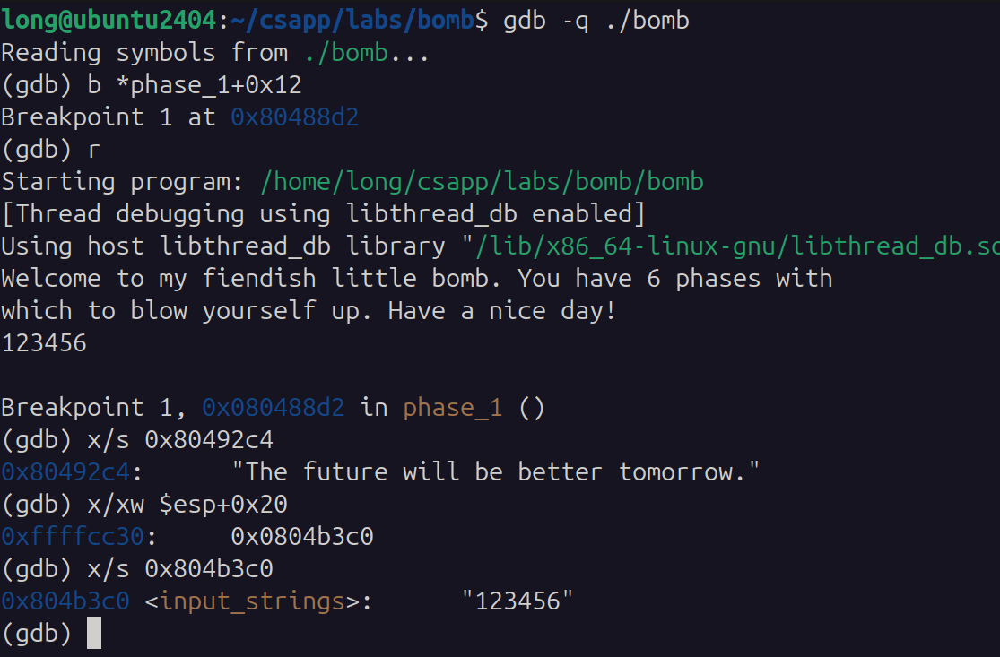
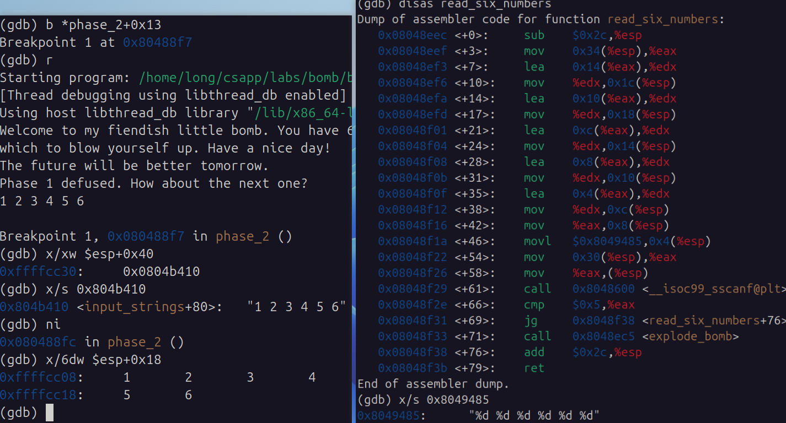
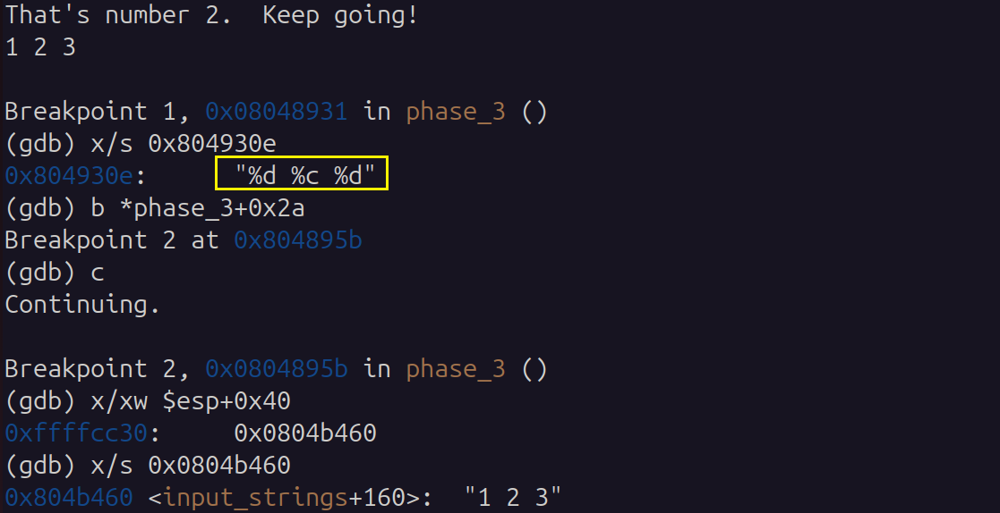
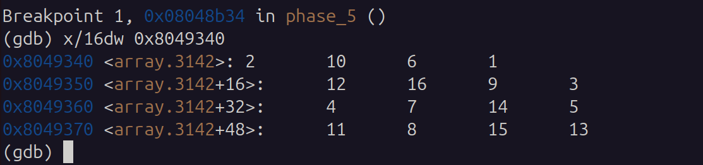
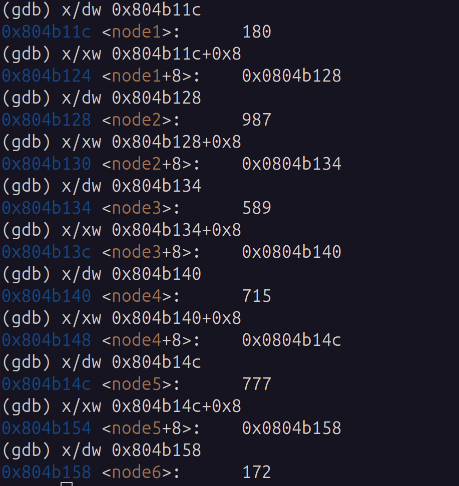
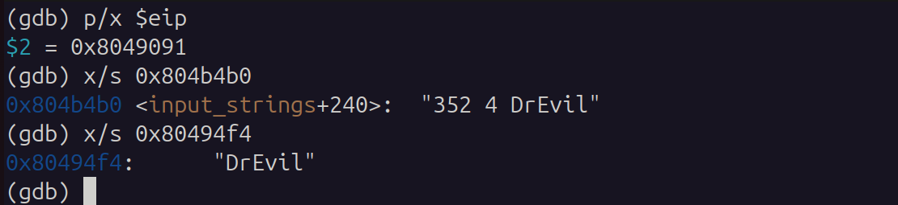
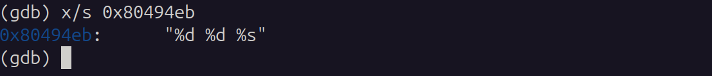
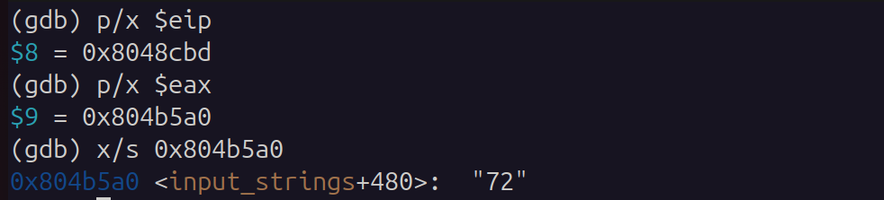
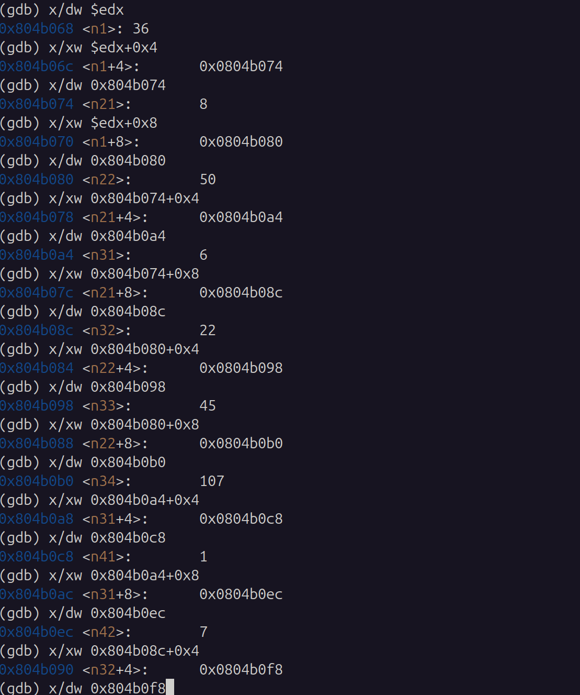

<!-- 封面页 -->
<div style="font-family: 'Microsoft YaHei', 'SimHei', sans-serif; background:#ffffff; width:90%; max-width:800px; margin:0 auto; padding:80px 40px; min-height:700px;">
  <h1 style="text-align:center; font-size:32px; font-weight: bold; margin:0 0 60px 0;">《计算机系统》</h1>
  <h2 style="text-align:center; font-size:28px; font-weight: bold; margin:0 0 180px 0;">Lab02 Bomb 实验报告</h2>
  <div style="font-size:20px; text-align:center; line-height:2.2; font-weight: normal;">
    <div>班级：智能科学与技术专业</div>
  </div>
</div>

<!-- 目录页（极简版） -->
<div style="font-family: 'Microsoft YaHei', 'SimHei', sans-serif; background:#ffffff; width:90%; max-width:800px; margin:40px auto; padding:40px 15; min-height:700px;">
  <h2 style="text-align:center; font-size:26px; font-weight: bold; margin-bottom:40px;">目录</h2>
  <div style="font-size:20px; line-height:2;">
    <div style="margin:6px 0; font-weight: bold;">1 实验项目</div>
    <div style="margin:6px 0; padding-left:32px; font-weight: bold;">1.1 项目名称</div>
    <div style="margin:6px 0; padding-left:32px; font-weight: bold;">1.2 实验目的</div>
    <div style="margin:6px 0; padding-left:32px; font-weight: bold;">1.3 实验资源</div>
    <div style="margin:6px 0; font-weight: bold;">2 实验任务</div>
    <div style="margin:6px 0; padding-left:32px; font-weight: bold;">2.1 阅读理解bomb.c</div>
    <div style="margin:6px 0; padding-left:32px; font-weight: bold;">2.2 Phase_1</div>
    <div style="margin:6px 0; padding-left:32px; font-weight: bold;">2.3 Phase_2</div>
    <div style="margin:6px 0; padding-left:32px; font-weight: bold;">2.4 Phase_3</div>
    <div style="margin:6px 0; padding-left:32px; font-weight: bold;">2.5 Phase_4</div>
    <div style="margin:6px 0; padding-left:32px; font-weight: bold;">2.6 Phase_5</div>
    <div style="margin:6px 0; padding-left:32px; font-weight: bold;">2.7 Phase_6</div>
    <div style="margin:6px 0; padding-left:32px; font-weight: bold;">2.8 隐藏关 secret_phase</div>
    <div style="margin:6px 0; font-weight: bold;">3 总结</div>
    <div style="margin:6px 0; padding-left:32px; font-weight: bold;">3.1 汇编阅读的关键点总结</div>
    <div style="margin:6px 0; padding-left:32px; font-weight: bold;">3.2 实验中出现的问题</div>
    <div style="margin:6px 0; padding-left:32px; font-weight: bold;">3.3 心得体会</div>
  </div>
</div>

### 1 实验项目
#### 1.1 项目名称
Bomb 实验

#### 1.2 实验目的
- 通过阅读理解六个Phase的IA32 AT&T汇编代码(包括一些小函数), 提高**汇编的阅读能力**
- 借助六个phase明白课程所教的**条件分支, 循环等控制结构**, 已经程序"过程"的**参数转移, 栈帧开辟**j细节
- 使用GDB调试工具, 熟练查看内存, 反汇编, 单步执行等**调试方法**, 来分析程序的运行过程

#### 1.3 实验资源
1. VMware17 构建虚拟机并安装Ubuntu24.04 桌面版, 以及在虚拟机中安装gcc编译器, gdb调试工具, objdump反汇编工具等, IA32 AT&T汇编环境
2. Lab02 Bomb实验的相关文件: `Bomblab参考思路.pdg`, `实验基本内容和要求.txt`, ...
3. Lab02 拆炸弹所需的汇编文件, 以及主要C代码: `bomb`, `bomb.c`
4. gdb调试工具, objdump反汇编指令

---

### 2 实验任务

#### 2.1 阅读理解bomb.c
通过阅读`bomb.c`, 我能够了解到**整个炸弹程序的运行流程**, 以及**每个phase的参数个数**. 下面是`bomb.c`的部分代码片段
```C
FILE *infile;
int main(int argc, char *argv[])
{
    char *input;

    if (argc == 1) { infile = stdin;} 
    else if (argc == 2) {
	if (!(infile = fopen(argv[1], "r"))) {
	    printf("%s: Error: Couldn't open %s\n", argv[0], argv[1]);
	    exit(8);}
    }
    ...
}
```
该段代码说明可执行文件`bomb`可以接受0个或1个参数, 如果没有参数, 则从标准输入读取输入; 如果有一个参数, 则从该文件中读取输入.
```C
    input = read_line();             /* Get input                   */
    phase_1(input);                  /* Run the phase               */
    phase_defused();                 /* Drat!  They figured it out! */
    printf("Phase 1 defused. How about the next one?\n");

    ...
```
根据该段代码可以知道, 每个Phase都是一个函数, 并且**只接受一个参数`input`**, 该参数是从输入中读取的一行字符串, 具体来说是**一个字符数组的首地址**

---

#### 2.2 Phase_1
反汇编`phase_1`函数, 得到汇编代码如下:
```c
<phase_1>:
  0x080488c0 <+0>:     sub    $0x1c,%esp
  0x080488c3 <+3>:     movl   $0x80492c4,0x4(%esp)
  0x080488cb <+11>:    mov    0x20(%esp),%eax
  0x080488cf <+15>:    mov    %eax,(%esp)
  0x080488d2 <+18>:    call   0x8048dba <strings_not_equal>
  0x080488d7 <+23>:    test   %eax,%eax
  0x080488d9 <+25>:    je     0x80488e0 <phase_1+32>
  0x080488db <+27>:    call   0x8048ec5 <explode_bomb>
  0x080488e0 <+32>:    add    $0x1c,%esp
  0x080488e3 <+35>:    ret
```
`phase_1`较为简单, 是一个**条件分支**

##### 2.2.1 大致过程
主要是**调用了一个字符串比较函数`strings_not_equal`**, 在`call`之前分别传递了两个参数到`(%esp)`和`0x4(%esp)`, 由此可知, 第一个参数是输入的字符串, 第二个参数是预设的字符串.
`strings_not_equal`函数会比较这两个字符串是否相等:
1. **相等**: 返回`%eax`的值为0;
2. **不相等**: 返回`%eax`的值为1;

需要的是**两个参数都是字符数组的指针**
之后根据`%eax`的值, 进行条件跳转...

##### 2.2.2 gdb调试
只用gdb调试, 看到自己的输入和预设字符串(`0x80492c4`处)的值


##### 2.2.3 答案
由`x/s 0x80492c4`可以看到预设字符串的值为:
```text
The future will be better tomorrow.
```

---

#### 2.3 phase_2
```C
<phase_2>
  0x080488e4 <+0>:     push   %ebx
  0x080488e5 <+1>:     sub    $0x38,%esp

  0x080488e8 <+4>:     lea    0x18(%esp),%eax
  0x080488ec <+8>:     mov    %eax,0x4(%esp)
  0x080488f0 <+12>:    mov    0x40(%esp),%eax
  0x080488f4 <+16>:    mov    %eax,(%esp)
  0x080488f7 <+19>:    call   0x8048eec <read_six_numbers>

  0x080488fc <+24>:    cmpl   $0x0,0x18(%esp)
  0x08048901 <+29>:    jns    0x8048925 <phase_2+65> // nums[0] 非负
  0x08048903 <+31>:    call   0x8048ec5 <explode_bomb>
  0x08048908 <+36>:    jmp    0x8048925 <phase_2+65>

  0x0804890a <+38>:    mov    %ebx,%eax
  0x0804890c <+40>:    add    0x14(%esp,%ebx,4),%eax
  0x08048910 <+44>:    cmp    %eax,0x18(%esp,%ebx,4)
  0x08048914 <+48>:    je     0x804891b <phase_2+55>
  0x08048916 <+50>:    call   0x8048ec5 <explode_bomb>
  // nums[i-1]+i == nums[i]
  0x0804891b <+55>:    add    $0x1,%ebx //initial i = 1
  0x0804891e <+58>:    cmp    $0x6,%ebx
  0x08048921 <+61>:    jne    0x804890a <phase_2+38>
  0x08048923 <+63>:    jmp    0x804892c <phase_2+72>

  0x08048925 <+65>:    mov    $0x1,%ebx 
  0x0804892a <+70>:    jmp    0x804890a <phase_2+38>
  
  0x0804892c <+72>:    add    $0x38,%esp
  0x0804892f <+75>:    pop    %ebx
  0x08048930 <+76>:    ret
```

##### 2.3.1 大致过程
`phase_2`主要部分是**一个循环**, 在开始循环之前, 会先`call`函数`read_six_numbers`, 该函数会**从输入字符串(`0x20(%esp)`)中读取6个整数**, 并将它们存放在`0x18(%esp)`到`0x38(%esp)`的内存地址中, 也就是**一个长度为6的整数数组**. 
进入循环后, 通过`ebx`寄存器来记录循环变量`i`, 循环条件是`i<6`, 循环体中会比较**当前元素是否等于前一个元素加上当前的索引值**: `nums[i] == nums[i-1]+i`, 如果不满足条件, 就会调用`explode_bomb`函数, 否则继续循环, 直到循环结束

##### 2.3.2 gdb调试


##### 2.3.3 答案
根据循环过程, 可以推断, 要想躲过`explode_bomb`, 答案比许符合以下形式:
```text
a, a+1, a+1+2, a+1+2+3, a+1+2+3+4, a+1+2+3+4+5
```
其中`a`必须是非负数

---

### 2.4 phase_3
`phase_3`篇幅很长, 但没有很难的, 基本都是根据条件跳转来判断输入的三个整数/字符是否满足特定的条件, 要想做第三题, 我觉得首要的是要**搞清楚需要输入答案的格式**, 要搞懂这些, 必须从`scanf`下手, 以下是`phase_3`关于将输入字符串转为整数的部分:
```c
<phase_3>:
  ...
  0x08048938 <+7>:     mov    %eax,0x10(%esp)
  0x0804893c <+11>:    lea    0x27(%esp),%eax
  0x08048940 <+15>:    mov    %eax,0xc(%esp)
  0x08048944 <+19>:    lea    0x28(%esp),%eax
  0x08048948 <+23>:    mov    %eax,0x8(%esp)
  0x0804894c <+27>:    movl   $0x804930e,0x4(%esp)
  0x08048954 <+35>:    mov    0x40(%esp),%eax
  0x08048958 <+39>:    mov    %eax,(%esp)
  0x0804895b <+42>:    call   0x8048600 <__isoc99_sscanf@plt>
  ...
```
我能够通过查看`scanf`函数的第二个参数**格式字符串**, 来知道输入的格式要求:

可以看到对答案的输入格式是`%d %d %c`, 也就是**两个整数和一个字符**

#### 2.4.1 答案
根据输入格式`%d %c %d`, 以及`phase_3`的前期对第一个`%d`的范围约束, 可以知道答案有以下八个:
```text
0 k 149
1 y 404
2 e 966
3 e 613
4 l 323
5 y 293
6 e 173
7 x 638
```

---

### 2.5 phase_4
`phase_4`主要涉及一个`func4`递归函数的调用, 该函数一个类似斐波那契数列函数的存在, 当然, 在`call func4`之前, 还会对输入的字符串转为所需形式`%d %d`, 然后进行范围约束, 只有输入的第二个整数在`2-4`之间, 才能继续执行, 否则就会调用`explode_bomb`

下面关于`func4`进行**详细分析**, **分析`func4`的接受参数数量和类型, `func4`的递归过程和递归结束点, 以及`func4`的返回值是什么**

首先看`phase_4`中对为`func4`进行的参数传递:
```c
<phase_4>:
  ...
  0x08048b11 <+61>:    mov    0x18(%esp),%eax
  0x08048b15 <+65>:    mov    %eax,0x4(%esp) // 输入的第二个整数存放位置
  0x08048b19 <+69>:    movl   $0x9,(%esp)    // 立即数9
  0x08048b20 <+76>:    call   0x8048a8a <func4>
  ...
```
由此可见, `func4`接受两个参数, 都是整数, 第一个参数是**输入的第二个整数**, 第二个参数是一个**立即数0x9**, 相当于:
```c
func4(int2, 9)
```
接下来分析`func4`的递归过程和结束点:
```c
<func4>:
  0x08048a8a <+0>:     push   %edi
  0x08048a8b <+1>:     push   %esi
  0x08048a8c <+2>:     push   %ebx
  0x08048a8d <+3>:     sub    $0x10,%esp

  0x08048a90 <+6>:     mov    0x20(%esp),%ebx // args[0]
  0x08048a94 <+10>:    mov    0x24(%esp),%esi // args[1]
  0x08048a98 <+14>:    test   %ebx,%ebx
  0x08048a9a <+16>:    jle    0x8048ac8 <func4+62>

  0x08048a9c <+18>:    mov    %esi,%eax       // 返回值初始化
  0x08048a9e <+20>:    cmp    $0x1,%ebx
  0x08048aa1 <+23>:    je     0x8048acd <func4+67>

  // 能运行到这里, 说明需要递归, 说明args[0] != 0或1
  0x08048aa3 <+25>:    mov    %esi,0x4(%esp)
  0x08048aa7 <+29>:    lea    -0x1(%ebx),%eax
  0x08048aaa <+32>:    mov    %eax,(%esp)   // func4(args[0]-1, int2)
  0x08048aad <+35>:    call   0x8048a8a <func4>
  0x08048ab2 <+40>:    lea    (%eax,%esi,1),%edi
  // 返回结果(%eax) += fun4(args[0]-1, int2)

  0x08048ab5 <+43>:    mov    %esi,0x4(%esp)
  0x08048ab9 <+47>:    sub    $0x2,%ebx
  0x08048abc <+50>:    mov    %ebx,(%esp)   // func4(args[0]-2, int2)
  0x08048abf <+53>:    call   0x8048a8a <func4>

  0x08048ac4 <+58>:    add    %edi,%eax //返回结果 += fun4(args[0]-2, int2)
  0x08048ac6 <+60>:    jmp    0x8048acd <func4+67>

  0x08048ac8 <+62>:    mov    $0x0,%eax
  0x08048acd <+67>:    add    $0x10,%esp
  0x08048ad0 <+70>:    pop    %ebx
  0x08048ad1 <+71>:    pop    %esi
  0x08048ad2 <+72>:    pop    %edi
  0x08048ad3 <+73>:    ret
```
如上可见, `func4`的递归非常类似斐波那契, 只不过每次返回都是多加了一个`int2`, 我们可以把`func4`当做一个看待, 那么该数列满足:
```text
func4(0, int2) = 0
func4(1, int2) = int2

func4(n, int2) = func4(n-1, int2) + func4(n-2, int2) + int2
```

#### 2.5.1 答案
根据`phase_4`在调用`func4`之后的语句可知, 他会拿`func4`的返回值和输入的第一个整数进行比较, 只有相等才不会爆炸, 由此可知, 输入的第一个整数必须是`func4(输入的第二个整数, 9)`的值
根据上述序列可以得知, func4(x, 9)为:
```text
0  1  2   3   4   5    6    7    8    9
0  x  2x  4x  7x  12x  20x  33x  54x  88x
```
结合前面第二个整数必须是`2`或`3`或`4`, 可以得到三个答案:
```text
176 2
264 3
352 4
```

---

### 2.6 phase_5
```c
<phase_5>
  0x08048b34 <+0>:     push   %ebx
  0x08048b35 <+1>:     sub    $0x18,%esp

  0x08048b38 <+4>:     mov    0x20(%esp),%ebx // $ebx = input_string首地址
  0x08048b3c <+8>:     mov    %ebx,(%esp)
  0x08048b3f <+11>:    call   0x8048d9b <string_length>

  0x08048b44 <+16>:    cmp    $0x6,%eax
  0x08048b47 <+19>:    je     0x8048b4e <phase_5+26>
  0x08048b49 <+21>:    call   0x8048ec5 <explode_bomb>

  // 这两句是在循环初始化
  0x08048b4e <+26>:    mov    $0x0,%edx // sum
  0x08048b53 <+31>:    mov    $0x0,%eax // i

  0x08048b58 <+36>:    movzbl (%ebx,%eax,1),%ecx // 获取字符串中第i个字符
  0x08048b5c <+40>:    and    $0xf,%ecx // 取ACSII码的低四位
  0x08048b5f <+43>:    add    0x8049340(,%ecx,4),%edx // sum += 
  0x08048b66 <+50>:    add    $0x1,%eax // i+=1
  0x08048b69 <+53>:    cmp    $0x6,%eax // i < 6
  0x08048b6c <+56>:    jne    0x8048b58 <phase_5+36>

  0x08048b6e <+58>:    cmp    $0x44,%edx // sum == 0x44 == 68
  0x08048b71 <+61>:    je     0x8048b78 <phase_5+68>
  0x08048b73 <+63>:    call   0x8048ec5 <explode_bomb>

  0x08048b78 <+68>:    add    $0x18,%esp
  0x08048b7b <+71>:    pop    %ebx
  0x08048b7c <+72>:    ret
```
第五题是一个很简单的**遍历**字符串**每个字符**, 然后利用**每个字符的二进制低四位**作为**映射表的索引**, 进而**取出映射表数组中的相应值**, 加和到`%edx`(即`sum`), 遍历完六个字符后, 得到`sum`的值, 与`0x44`进行比较, 只有相等才不会爆炸  

由于只取二进制低四位, 因此映射表需要用到的索引是`0x0`到`0xf`, 也就是`0-15`, 故用以下gdb指令查看映射表:

可以得到映射表为:
```text
index: 0   1   2   3   4   5   6   7   8   9   a   b   c   d   e   f
value: 2  10   6   1   12  16  9   3   4   7   14  5   11  8   15  13
```


#### 2.6.1 答案
从上所述, 答案可以有非常多个, 只要保证是六个字符的字符串, 然后把每个字符的第四位ASCII二进制值作为索引, 取出值之后在加和为68即可, 比如:
```text
555500                 # (4*arr[5] + 2*arr[0])
```
```text
,,,,,/                 # (5*arr[c] + 1*arr[f])
```

---

### 2.7 phase_6
`phase_6`的长度中等, 但难度较大, 主要是**一个链表的排序问题**, 该链表由六个节点组成, 每个节点包含一个整数和一个指向下一个节点的指针, 输入的字符串会被转为六个整数, 这六个整数分别代表了链表中六个节点的**位置**(1-based), 通过输入的六个整数, 对链表进行重新排序, 可以得到一个新的链表, 该链表需要满足**按照节点中的整数值进行降序排列**, 才能躲过`explode_bomb`

`phase_6`大致可以分为四个部分:
1. **判断六个整数不重复**: 通过两层循环, 比较六个整数两两之间是否相等, 如果有相等的, 就会调用`explode_bomb`
2. **根据六个整数对应六个节点, 将他们的地址顺序存起来**
3. **根据存储的六个节点地址对链表进行排序**
4. **判断排序后的链表是否满足降序排列**

#### 2.7.1 答案
根据代码, 首先需要查看**预设的链表**, 用gdb查看如下:


由此可知来链表为:
```text
180 -> 987 -> 589 -> 715 -> 777 -> 172 
```
因此要想利用输入的六个整数(1-6)来重新排序链表, 使得链表满足降序排列, 则输入的六个整数**应该是`2 5 4 3 1 6`**, 这样就能得到新的链表:

---
### 2.8 secret_phase隐藏关
表面上来看, `bomb.c`中并没有调用`secret_phase`, 但是在调用完`phase_6`之后, 还有一个`phase_defused`函数
这时候, 去翻看phase_defuse函数汇编代码, **会发现他的主体出现了:**
```c
80490b2:	e8 ea fb ff ff       	call   8048ca1 <secret_phase>
```

#### 2.8.1 隐藏关的触发
进一步分析`phase_defused`函数的汇编代码, 能够知道, 虽然前面几个`phase`函数调用之后都会紧接着调用`phase_defused`, 但是前面的`phase_defused`函数的主体部分是**一个条件分支**, 只有当满足**已经输入过六行字符**, 已经成功通过前面六个`phase`, 并且之前的某次输入触发特殊格式时, 才有可能进行到`call secret_phase`的语句:
```c
<phase_defused>:
  ...
  0x08049048 <+18>:    cmpl   $0x6,0x804b3a8
  0x0804904f <+25>:    jne    0x80490c3 <phase_defused+141> //输入六个字符串

  0x08049051 <+27>:    lea    0x2c(%esp),%eax
  0x08049055 <+31>:    mov    %eax,0x10(%esp)
  0x08049059 <+35>:    lea    0x28(%esp),%eax
  0x0804905d <+39>:    mov    %eax,0xc(%esp)
  0x08049061 <+43>:    lea    0x24(%esp),%eax
  0x08049065 <+47>:    mov    %eax,0x8(%esp)
  0x08049069 <+51>:    movl   $0x80494eb,0x4(%esp) // "%d %d %s"
  0x08049071 <+59>:    movl   $0x804b4b0,(%esp) 
  // 这里传递的是第四行输入, 也就是他判断的是第四关的输入
  0x08049078 <+66>:    call   0x8048600 <__isoc99_sscanf@plt>

```

```C
  0x0804907d <+71>:    cmp    $0x3,%eax // 必须输入了三个部分
  0x08049080 <+74>:    jne    0x80490b7 <phase_defused+129>

  0x08049082 <+76>:    movl   $0x80494f4,0x4(%esp) 
  // 比较第三个部分也就是字符串和预设的字符串是否相等
  0x0804908a <+84>:    lea    0x2c(%esp),%eax 
  0x0804908e <+88>:    mov    %eax,(%esp)
  0x08049091 <+91>:    call   0x8048dba <strings_not_equal>
  0x08049096 <+96>:    test   %eax,%eax
  0x08049098 <+98>:    jne    0x80490b7 <phase_defused+129> //相等就继续执行
  ...
  0x080490b2 <+124>:   call   0x8048ca1 <secret_phase> //就能执行到这一布

  0x080490b7 <+129>:   movl   $0x8049418,(%esp)
  ...
  0x080490be <+136>:   call   0x80485c0 <puts@plt>
  ...
  0x080490db <+165>:   ret
```





#### 2.8.2 隐藏关分析求解
进入隐藏关, 基本还是按照前面的步骤, 明确`secret_phase`的参数, 他是否将输入的字符串转为整数, 以及`secret_phase`的主体逻辑是什么
```C
<secret_phase>:
  ...
  8048cba:	89 04 24             	mov    %eax,(%esp) // input_string
  8048cbd:	e8 6e f9 ff ff       	call   8048630 <strtol@plt>
  // string to long

  8048cc2:	89 c3                	mov    %eax,%ebx
  8048cc4:	8d 40 ff             	lea    -0x1(%eax),%eax
  8048cc7:	3d e8 03 00 00       	cmp    $0x3e8,%eax
  8048ccc:	76 05                	jbe    8048cd3 <secret_phase+0x32>
  8048cce:	e8 f2 01 00 00       	call   8048ec5 <explode_bomb>

  // 1<=input<=1001
  8048cd3:	89 5c 24 04          	mov    %ebx,0x4(%esp)  
  // args[1]=input
  8048cd7:	c7 04 24 68 b0 04 08 	movl   $0x804b068,(%esp) 
  // args[0]
  8048cde:	e8 6d ff ff ff       	call   8048c50 <fun7>
```
**分析主体逻辑**可以知道:
从`phase_defused`中传递参数的方式可以知道, `secret_phase`接受一个参数, 是一个字符串的首地址, 该字符串是用户输入的第七行输入, `secret_phase`会将该字符串转为整数, 之后对整数进行范围约束, 只有在`1-1001`之间才不会爆炸, 接下来会调用一个函数`fun7`, 该函数的参数是**两个整数**, 第一个整数是**预设的整数0x804b068**(后续可以看出, 这就是一个地址, 并且`fun7`是递归调用, 每次传递的地址不一样), 第二个整数是**输入转为整数的值**, `fun7`的返回值是一个整数, 该返回值必须为0才不会爆炸
以下是用gdb验证`secret_phase`接受的参数确实为输入的第七行字符串的首地址:


##### 接下来进入fun7的分析
```c
<fun7>:
  0x08048c50 <+0>:     push   %ebx
  0x08048c51 <+1>:     sub    $0x18,%esp

  0x08048c54 <+4>:     mov    0x20(%esp),%edx // $edx = args[0]
  0x08048c58 <+8>:     mov    0x24(%esp),%ecx // $ecx = args[1]
  0x08048c5c <+12>:    test   %edx,%edx
  0x08048c5e <+14>:    je     0x8048c97 <fun7+71>
 
  // args[0] != 0
  0x08048c60 <+16>:    mov    (%edx),%ebx
  0x08048c62 <+18>:    cmp    %ecx,%ebx
  0x08048c64 <+20>:    jle    0x8048c79 <fun7+41>

  // if M[arg[0]]>input_num
  0x08048c66 <+22>:    mov    %ecx,0x4(%esp)
  0x08048c6a <+26>:    mov    0x4(%edx),%eax // 左节点地址
  0x08048c6d <+29>:    mov    %eax,(%esp)
  0x08048c70 <+32>:    call   0x8048c50 <fun7>
  0x08048c75 <+37>:    add    %eax,%eax // 返回结果x2
  0x08048c77 <+39>:    jmp    0x8048c9c <fun7+76>
  
  // if M[arg[0]]<=input_num
  0x08048c79 <+41>:    mov    $0x0,%eax
  0x08048c7e <+46>:    cmp    %ecx,%ebx
  0x08048c80 <+48>:    je     0x8048c9c <fun7+76>

  // if M[arg[0]]<input_num
  0x08048c82 <+50>:    mov    %ecx,0x4(%esp)
  0x08048c86 <+54>:    mov    0x8(%edx),%eax //右节点地址 
  0x08048c89 <+57>:    mov    %eax,(%esp)
  0x08048c8c <+60>:    call   0x8048c50 <fun7>
  0x08048c91 <+65>:    lea    0x1(%eax,%eax,1),%eax // 返回结果x2+1
  0x08048c95 <+69>:    jmp    0x8048c9c <fun7+76>
```

```C
  // 遇到零地址就返回-1, 递归终止
  0x08048c97 <+71>:    mov    $0xffffffff,%eax
  0x08048c9c <+76>:    add    $0x18,%esp
  0x08048c9f <+79>:    pop    %ebx
  0x08048ca0 <+80>:    ret
```
可以发现: `fun7`会根据输入的整数值与当前args[0]所指向内存里整数值进行比较, 来决定下一步的递归调用:
1. `args[0]`为**零地址**: 直接返回-1, **递归结束**
2. `args[0]`所**指向的整数值大于输入整数值**: 递归调用`fun7(args[0]+0x4, input_num)`, 返回结果x2
3. `args[0]`所**指向的整数值等于输入整数值**: 返回结果0, **递归结束**
4. `args[0]`所**指向的整数值小于输入整数值**: 递归调用`fun7(args[0]+0x8, input_num)`, 返回结果x2+1

会发现每次递归调用, 第一个参数要么是`args[0]+0x4`, 要么是`args[0]+0x8`, 此时我们想到他是在访问一个二叉树, 该二叉树由节点地址和节点值组成, 每个节点包含一个整数值, 以及指向左子节点(**`args[0]+0x4`处的内存**)和右子节点的指针(**`args[0]+0x8`处的内存**), 那么我们首先需要知道**预设的二叉树是什么样子的**, 通过gdb查看如下:


由此可以知道他是一个二叉搜索树BST:
```text
                36*
        ┌───────┴───────┐
        8*              50
    ┌───┴───┐       ┌───┴───┐
    6*     22       45      107
  ┌─┴─┐  ┌─┴─┐    ┌─┴─┐   ┌──┴──┐
  1*  7 20  35   40  47  99    1001
```
由此可知, 要想让`fun7`的返回值为0, 就必须让输入整数值等于树中某个节点的整数值, 递归过程还不能遍历到右节点, 不然返回值`x2 + 1`就不为0了, 综上答案有4:
```text
36
8 
6
1
```

---
### 3.总结
#### 3.1 阅读汇编的关键点总结
##### (1) 能够熟悉一些函数尤其是scanf函数的参数传递
**通过scanf**的参数传递, 搞清楚输入的格式要求, 以及输入的字符串被转为什么样的参数(格式字符串)传递给后续函数
```c
 # third part of input (? bytes)
 8048934:	8d 44 24 2c          	lea    0x2c(%esp),%eax
 8048938:	89 44 24 10          	mov    %eax,0x10(%esp)

 # second part of input (1 bytes)
 804893c:	8d 44 24 27          	lea    0x27(%esp),%eax
 8048940:	89 44 24 0c          	mov    %eax,0xc(%esp)

 # first part of input (4 bytes)
 8048944:	8d 44 24 28          	lea    0x28(%esp),%eax
 8048948:	89 44 24 08          	mov    %eax,0x8(%esp)

 # standard args of scanf
 804894c:	c7 44 24 04 0e 93 04 	movl   $0x804930e,0x4(%esp)
 8048953:	08 

 # get input (args[0]) 
 8048954:	8b 44 24 40          	mov    0x40(%esp),%eax
 8048958:	89 04 24             	mov    %eax,(%esp)

 804895b:	e8 a0 fc ff ff       	call   8048600 <__isoc99_sscanf@plt>
```
在从`scanf`的不同参数有不同的含义, 从第一个参数(`(%esp)`)能够窥见程序输入的字符串, 从第二个参数能够知晓**格式字符串**, 也就是输入的格式要求, 从第三个参数(`(0x8(%esp))`)开始, 就是**输入字符串被转为的特定格式的参数**, 这些参数存在当前帧栈中, 用于后续被使用

##### (2) 清楚被调用者开辟栈帧后, 需要的参数位置在哪
被调用者开辟栈帧后, 其参数位置要根据开辟过程中`%esp`的变化来确认, 假如某个被调用者在开辟栈帧时, `%esp`由于`pushl`和`sub`的操作, 向下移动了0x20, 那么该被调用者的第一个参数位置(原来的`(%esp)`)就应该在`0x20(%esp)`处

##### (3) 关于递归要能够清楚递归传递和递归终止
递归函数的分析, 首先要搞清楚**递归函数接受的参数数量和类型**以及**每次进一步递归过程中参数传递的变化**, 其次要分析**递归函数的递归过程和递归结束点**, 最后要分析**递归函数的返回值是什么**

##### (4) 要能够分部分来阅读汇编
对于篇幅较长的汇编代码, 可以先**大致浏览**一遍, 了解整体流程, 然后**分部分来阅读**, 每部分都要弄清楚**该部分的功能是什么**, **该部分的输入是什么**, **该部分的输出是什么**, **该部分的实现细节是什么**

#### 3.2 实验中出现的问题

##### (1) 分不清楚这个内存里存的是值, 还是值
一开始进行闯关时, 经常会遇到一些内存地址, 不清楚该内存地址里存的是一个值, 还是一个地址, 后来通过研究和试错后大致清楚了一方面**要清楚一些常见的用于指向数据类型的指针**, 一方面要**能够通过上下文分析, 清楚这些地方就是是什么**
比如`phase_1`中, 一开始并不清楚传递给`strings_not_equal`函数的第一个参数`20(%esp)`是什么, 一开始一直在尝试用`x/s $esp+20`来查看, 一直没有看到想要的结果, 研究一番才知道这个`$esp+20`其实是一个**指针**, 该指针指向了一个字符串, 因此要想查看这个字符串, 需要先用`x/wx $esp+20`来查看这个指针的值, 得到一个地址之后, 再用`x/s 地址`来查看字符串


#### 3.3 实验心得体会
