<!-- 封面页 -->
<div style="font-family: 'Microsoft YaHei', 'SimHei', sans-serif; background:#ffffff; width:90%; max-width:800px; margin:0 auto; padding:80px 40px; min-height:700px;">
  <h1 style="text-align:center; font-size:32px; font-weight: bold; margin:0 0 60px 0;">《计算机系统》实验三</h1>
  <h2 style="text-align:center; font-size:28px; font-weight: bold; margin:0 0 180px 0;"> 最小ELF可执行文件 实验报告</h2>
  <div style="font-size:20px; text-align:center; line-height:2.2; font-weight: normal;">
    <div>班级：智能科学与技术专业</div>
  </div>
</div>

<div style="font-family: 'Microsoft YaHei', 'SimHei', sans-serif; background:#ffffff; width:90%; max-width:800px; margin:40px auto; padding:40px 15; min-height:700px;">
  <h2 style="text-align:center; font-size:26px; font-weight: bold; margin-bottom:40px;">目录</h2>
  <div style="font-size:20px; line-height:2;">
    <div style="margin:6px 0; font-weight: bold;">1 实验简介</div>
    <div style="margin:6px 0; padding-left:32px; font-weight: bold;">1.1 实验目标</div>
    <div style="margin:6px 0; padding-left:32px; font-weight: bold;">1.2 实验原理</div>
    <div style="margin:6px 0; padding-left:32px; font-weight: bold;">1.3 实验环境</div>
    <div style="margin:6px 0; padding-left:32px; font-weight: bold;">1.4 实验机制</div>
    <div style="margin:6px 0; font-weight: bold;">2 实验任务</div>
    <div style="margin:6px 0; padding-left:32px; font-weight: bold;">2.1 阶段一</div>
    <div style="margin:6px 0; padding-left:32px; font-weight: bold;">2.2 阶段二</div>
    <div style="margin:6px 0; padding-left:32px; font-weight: bold;">2.3 阶段三</div>
    <div style="margin:6px 0; padding-left:32px; font-weight: bold;">2.4 阶段四</div>
    <div style="margin:6px 0; padding-left:32px; font-weight: bold;">2.5 阶段五</div>
    <div style="margin:6px 0; padding-left:32px; font-weight: bold;">2.6 阶段六</div>
    <div style="margin:6px 0; font-weight: bold;">3 实验总结</div>
    <div style="margin:6px 0; padding-left:32px; font-weight: bold;">3.1 密钥提交</div>
    <div style="margin:6px 0; padding-left:32px; font-weight: bold;">3.2 实验总结</div>
  </div>
</div>

<br>

## 1 实验简介
### 1.1 实验目标
- 深入理解ELF文件结构
- 掌握 Linux 系统调用机制
- 理解链接器的工作原理
- 体验机制优化的思维方式
### 1.2 实验原理
1. **ELF文件结构**
    - **ELF头:** 描述文件的基本属性和其他关键数据结构的位置和大小, 对于32位系统固定为52字节, 包含了魔数、文件类型、机器架构、入口点地址、程序头表偏移、节头表偏移等信息
    - **程序头表:** 是一个结构体数组, 每个条目描述一个段(Segment), 段是运行时的视图: 它将多个具有相同权限(读/写/执行)的节(section)合并在一起, 告知操作系统如何加载文件的不同部分到内存
    - **节头表:** 描述文件中各个节(section)的属性和位置, 包含了节的名称、类型、地址、偏移、大小等信息, 主要用于链接器和调试器, 对于可执行文件是**可选**的
2. **各指令作用**
    - **`nasm -f bin a.out -o tiny.asm`:** 将汇编源文件 `tiny.asm` 编译成**纯二进制**文件, `-f bin` 不生成任何文件头, 节头表或重定位信息, 只是把汇编代码和伪指令(如和`db, org`)直接转换为字节序列 
    - **`chmod +x a.out`:** 使用`nasm -f bin` 或`ld`直接生成文件时, 默认权限可能不是可执行, 需要手动`chmod`, `gcc` 默认生成的文件已经自带可执行权限
    - **`nasm -f elf_i386 tiny.asm -o tiny.o`:** 表示生成一个 ELF 格式的目标文件(可重定位文件`tiny.o`)
### 1.3 实验环境
- 操作系统: Linux (Ubuntu 24.04)
- 编译器: nasm, gcc, ld
- 工具: readelf, xxd, wc, strip
  
---
---

## 2 实验任务
### 2.1 阶段一: C程序基础分析和优化

##### **编写基础 C 程序**
```C
/* tiny.c */
int main() {
    return 040413;
}
```
##### **编译并查验大小**
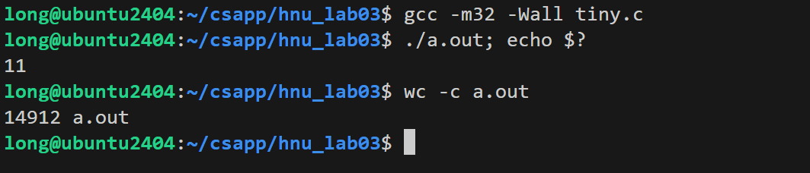

补充: Linux 程序的推出状态码只能是0-255之间的整数, `040413` 被视为八进制数, 并且内核 **只取`ebx`寄存器的低8位** 作为返回值, 所以实际返回值是 `11`

> 问: 这个可执行文件有多大？如果要减小可执行代码，从C代码层次能进一步简化吗？求助于gcc呢？

**答:** 该可执行文件的大小是 `14912` 字节, 从C代码层次来看, 已经非常简洁了, 只有一个 `main` 函数和一个返回语句, 没有任何冗余的代码可以去掉了; 但是从编译器层面来看, GCC 默认会引入很多额外的代码和数据, 包括: 标准库函数的调用 (如 `__libc_start_main`), 这会引入大量的启动代码和库函数, 调试信息和符号表, 这会增加文件大小, 以及一些默认的链接器脚本会引入额外的段和节, 这些都会增加文件大小

---

##### **使用`strip`优化**


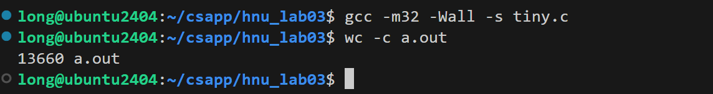

##### **使用编译器优化**
**原理:** `-O3` 是 GCC 的**最高级别代码优化选项:**

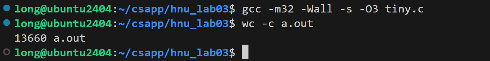

##### **问题回答**
> 问1: `strip`命令移除了什么内容？为什么可以减小文件大小？

- **答:** `-s` 是 GCC 的一个编译选项，：它会直接从可执行文件中**移除：**
    - **符号表（函数 / 变量名）**
    - **调试信息**
    - **重定位信息**

这些信息对程序运行没用，只对调试有用，移除后文件体积会明显变小。

> 问2: 为什么-O3优化对这么简单的程序效果不明显？

- **答:** `-O3` 是 GCC 的最高级别优化, 主要目标是**提升性能**, 通过**循环展开**, **函数内联**, **矢量化** 等技术来优化代码.
程序本身只有一个`return`, 非常简单, `-O3` 没有任何可以优化的目标

> 问3 你认为这个C程序生成的可执行文件中，实际执行的代码占多大比例？

- **答:**  执行的代码只有一句 `return 040413;`，编译成机器码后大约是 `3-5` 字节, 其余大部分都是ELF头, 链接信息, 以及`-s`没有一处的结构对齐填充, 因此实际执行代码占比非常非常低.

##### **阶段验证记录**
|项目|文件大小（字节）|
|:-|:-:|
|原始文件|`14912`|
|`strip` 后大小|`13660`|
|`-O3` 优化后|`13660`|

---

##### **阶段一解锁密钥:** `14912-13660-13660`
(三个EXEC大小用连字符连接)

---

---

### 2.2 阶段二: 汇编改写和系统调用
阶段一中, `returin` 只是从`main`函数返回到了启动代码, 接下来会直接操作寄存器, 将C程序改写为汇编语言, **去除C运行时库的依赖,** 直接使用Linux系统调用退出程序

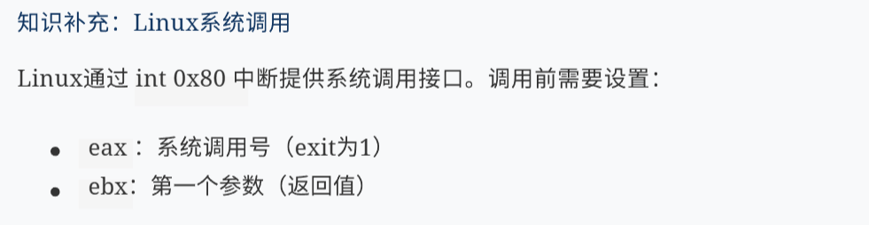

##### **编写汇编程序**
创建 `tiny.asm` 文件, 填写缺失的值:
```asm
; tiny.asm
BITS 32          ; 指定生成 32 位代码
GLOBAL _start    ; 声明 _start 为全局入口, 使得后面的ld知道程序入口在哪
; 这样的信息后续会被 strip 指令删除, 不会进入到最终的可执行文件
SECTION .text    ; 声明接下来的代码放入.text 节

_start:
    mov eax, 1        ; exit 系统调用号, 固定为 1 (5字节)
    mov ebx, 040413   ; 程序的返回值 (5字节)
    int 0x80          ; 触发 Linux 系统调用(2字节)
```

##### **编译并验证**
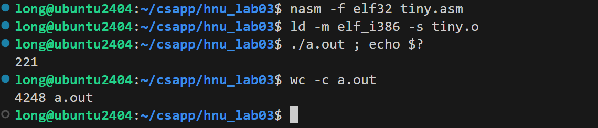

`nasm -f elf tiny.asm` 表示生成一个 ELF 格式的目标文件(可重定位文件`tiny.o`)

##### **指令优化**


##### **结果**
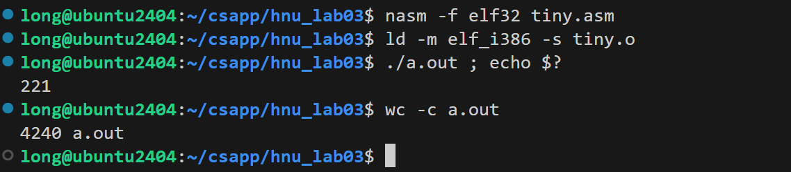

##### **阶段验证记录**
|项目|大小（字节）|
|:-|:-:|
|优化前文件大小| `4248` |
|优化后文件大小| `4240`|
|节省的字节数| `8` |
---

##### **阶段二解锁密钥:** `16968`
(计算: 优化后大小 x 4 + 节省字节数)

---

---

### 2.3 阶段三: 去除库依赖与链接优化


节头表用 `readelf -S a.out`查看, 程序头表用 `readelf -l a.out`查看

> 问: 对于可执行文件，节头表是可选的！why?

- **答**: 对于可执行文件(EXEC), 节头表是可选的, 节头表是给 **链接器**, 调试器, 反汇编工具用的, Linux 内核加载可执行文件时, **只看程序头表, 不看节头表**
对于EXEC, 程序头表是强制必须存在的, 他**会告诉操作系统内核"如何将文件的内容映射到进程地址空间"**

---

##### **分析当前 ELF 结构**

> 问: gcc时，使用 `-nostdlib` , 将取消链接标准库和相关启动代码, 然后你就会遇到 `_start` 未定义报错，why？
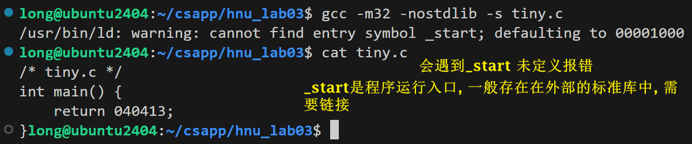

- **答:** 一个 C 程序 (即使只有一个 main) 在编译链接时, 真正的入口点不是 `main`, 而是 `_start` (由 C 运行时启动代码提供, 例如 启动文件`crt1.o` 中的 `_start`).
`_start` 负责初始化环境 (栈、寄存器、调用 `__libc_start_main`), 然后才调用 `main`. `main` 返回后, `_start` 再调用 `exit` 进行清理.


##### **在`_start`中直接执行**
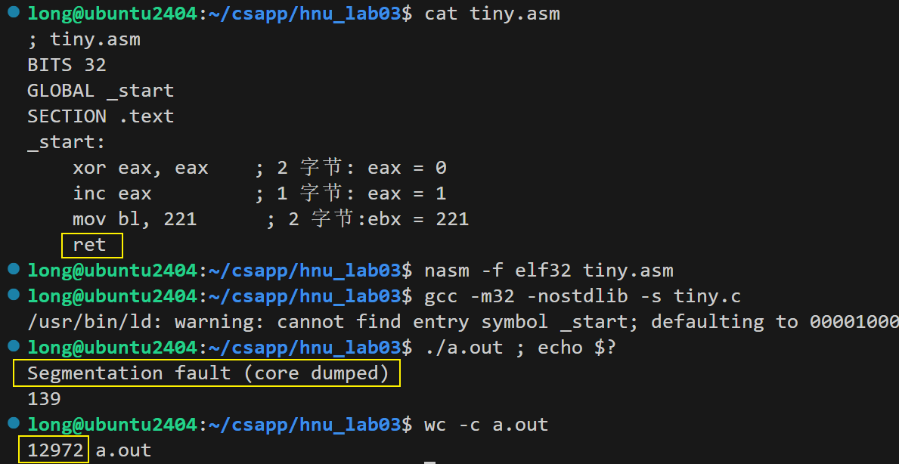


##### **使用`ld`链接器**
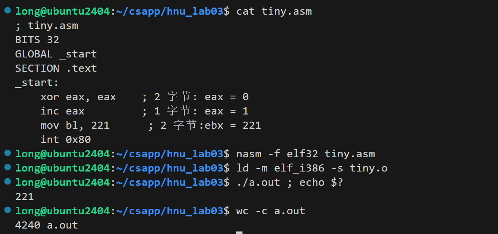

---

##### **理解大小变化**
> 问: gcc链接时默认添加了哪些内容？TA为什么要增加这些内容？
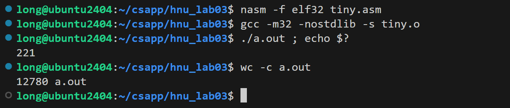

- **答:** 查看两种链接方式的节头表
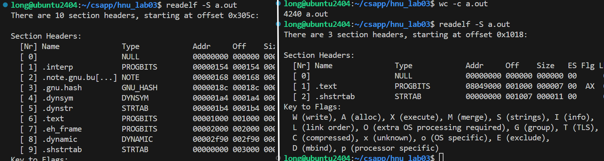
gcc链接会默认生成**动态链接**的可执行文件, 即使使用了`-nostdlib`, 也会引入一些动态链接相关的段和节, 包括: `.interp`, `dynamic`, `.dynsym`, `.dynstr` 等, 这些段和节会增加文件大小


> 问: `ld` 链接的文件为什么更小 

- **答:** ld生成的文件只有两个节头, `.text`, `dynamic`
因为相比于gcc链接, ld没有引入动态链接相关的段和节, 也不会添加任何的调试/标识节, 因此文件大小大幅减少

---

##### **阶段三解锁密钥:** `LD-4240`  
(`LD-ld链接后字节数`)

---
---

### 2.4 阶段四 -- 手动构建ELF头和程序头
前面说到节头表是不必要的, 前面用gcc和ld生成的文件都包含了节头表, 现在将**完全手动构建一个最小的ELF可执行文件**, 只包含必要的**ELF头和程序头**
并利用`nasm -f bin` 直接生成一个**纯二进制**的可执行文件, 不包含任何节头表, 也不依赖于链接器

**补充知识**
1. **ELF头**在32位系统中固定位52字节, **描述了文件的基本属性和其他关键数据结构的位置和大小.**
2. **程序头表**是一个结构体数组, 每个条目描述一个**段(Segment),** 段是运行时的视图: 它将多个具有相同权限(读/写/执行)的姐(section)合并在一起, **告知操作系统如何加载文件的不同部分到内存**

##### **`tiny.asm`: 补全ELF模版代码**
```asm
; tiny.asm 手动构建ELF头
; db/dw/dd会实实在在变成输出文件里的二进制数据, 其他的信息只用于只是和汇编计算
; $ 表示当前行的汇编地址(相对于org的虚拟地址)
; $$ 表示当前section的其实虚拟地址, 这里只有一个隐式section, 所以$$就是org的地址
BITS 32
org 0x08048000   
; 设置汇编地址计数器（当前代码/数据的预期加载虚拟地址）。后面的 $、$$ 都基于这个基准。

ehdr:           ; Elf32_Ehdr
    db 0x7F, "ELF", 1, 1, 1, 0   ; 1 + 3 + 1 + 1 + 1 + 1 = 8 字节  
    ; e_ident 0x7F + 'E','L','F' → 固定魔数 7F 45 4C 46
    times 8 db 0                ; 填充八次 db 0, 即运行八次 db 0
    dw 2                        ; e_type = 2 (ET_EXEC, 可执行文件)   ?
    dw 3                        ; e_machine = 3 (EM_386, x86架构)    ?
    dd 1                        ; e_version = 1 (当前版本)           ?
    dd _start                   ; e_entry = 程序入口地址
    dd phdr - $$                ; e_phoff = 程序头表在文件中的偏移
    dd 0                        ; e_shoff = 0 (无节头表)            ?
    dd 0                        ; e_flags = 0 (无特殊标志)          ?
```
续
```asm
    dw ehdrsize                 ; e_ehsize = ELF头大小  
    dw phdrsize                 ; e_phentsize = 程序头表项大小
    dw 1                        ; e_phnum = 1 (1个程序头表项)        ?
    dw 0                        ; e_shentsize = 0 (无节头表项)       ?
    dw 0                        ; e_shnum = 0 (无节头表项)           ?
    dw 0                        ; e_shstrndx = 0 (无节头字符串表)    ?
ehdrsize equ $ - ehdr

phdr:           ; Elf32_Phdr
    dd 1                        ; p_type = 1 (PT_LOAD, 可加载段)   ?
    dd 0                        ; p_offset = 0 (段在文件中的偏移)   ?
    dd $$                       ; p_vaddr = 虚拟地址(加载地址)
    dd $$                       ; p_paddr = 物理地址(忽略)
    dd filesize                 ; p_filesz = 段在文件中的大小
    dd filesize                 ; p_memsz = 段在内存中的大小
    dd 5                        ; p_flags = 5 (R+E, 可读+可执行)    ?
    dd 0x1000                   ; p_align = 0x1000 (页对齐)

phdrsize equ $ - phdr

_start:         ; 程序入口
    mov bl, 221     ; 2 字节          ?
    xor eax, eax    ; 2 字节
    inc eax         ; 1 字节
    int 0x80        ; 2 字节

filesize equ $ - $$
```

##### **编译并测试**
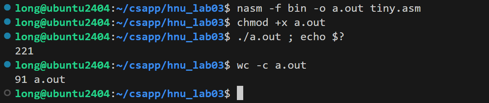

##### **分析文件结构**
```bash
xxd a.out | head -20   # 查看二进制可执行文件前20行的十六进制内容
```

##### **验证 ELF 魔数**
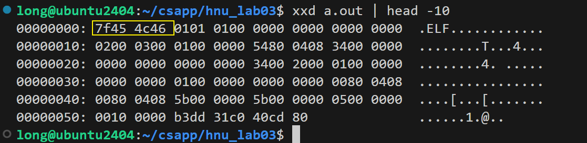

---

##### **问题解答**
> 问: ELF头大小 + 程序头表大小 = ? 字节

- **答**: `ehdrsize` + `phdrsize` = 52 + 32 = 84 字节

> 问: 程序代码大小 = ? 字节

- **答**: `_start` 部分指令机器码长度, 总共为 `2+2+1+2 = 7` 字节
    - `mov bl, 221` : 2 字节
    - `xor eax, eax` : 2 字节
    - `inc eax` : 1 字节
    - `int 0x80` : 2 字节

> 问: 文件总大小是否等于上述之和? 为什么?

- **答**: 根据`wc -c a.out`命令显示, 文件总大小是 `91` 字节, 确实等于 ELF头大小 (52字节) + + 程序头表(32字节) + 程序代码大小 (7字节) 的和
这次生成可执行文件没有经过链接器, 因此不会有任何的填充对齐, 也没有节头表等额外内容, 因此文件大小就是上述三部分的简单相加

---

##### **阶段四解锁密钥:** 91*2 - 7 = `175`   (文件大小 x 2 - 程序代码大小)

---
---

### 2.5 阶段五 -- 结构重叠优化
通过让程序头表于ELF头重叠, 可以进一步减小文件大小 

**重叠原理**
ELF头的最后8字节 (`e_shentsize, e_shnum, e_shstrndx`) 与程序头表的前8字节 (`p_type, p_offset`) 在位置上重叠. 如果能让这两个区域的内容同时满足两个结构的语义，就能节省8个字节

##### **编写重叠版本代码**
```asm
; tiny.asm 阶段五：ELF头与程序头表重叠优化
BITS 32
org 0x08048000

ehdr:
    db 0x7F, "ELF", 1, 1, 1, 0  ; e_ident
    db 0    ; 1 字节

_start:   
; 代码段直接嵌入到ELF头中间, 总共为 7 字节
    mov bl, 221
    xor eax, eax
    inc eax
    int 0x80
```
续
```asm
    dw 2            ; e_type = 2 (ET_EXEC)            ?
    dw 3            ; e_machine = 3 (EM_386)          ?
    dd 1            ; e_version = 1 (当前版本)         ?
    dd _start       ; e_entry = 入口地址
    dd phdr - $$    ; e_phoff = 程序头表偏移
    dd 0            ; e_shoff = 0（无节头表）          ? 
    dd 0            ; e_flags = 0 (无特殊标志)         ?
    dw ehdrsize     ; e_ehsize = ELF头大小
    dw phdrsize     ; e_phentsize = 程序头表项大小

phdr:
    dd 1            
    ;  p_type = 1, 同时也是e_phnum = 1, 也是e_shentsize=0 (小端法)
    dd 0            
    ;  p_offset=0, 同时也是e_shnum=0, e_shstrndx=0    ?

ehdrsize equ $ - ehdr

    dd $$           ; p_vaddr = 虚拟地址
    dd $$           ; p_paddr = 物理地址（忽略）
    dd filesize     ; p_filesz = 文件大小
    dd filesize     ; p_memsz = 内存大小
    dd 5            ; p_flags = 5 ; R+E, 可读+可执行    ?
    dd 0x1000       ; p_align = 页对齐

phdrsize equ $ - phdr

filesize equ $ - $$
```

##### **编译并验证**
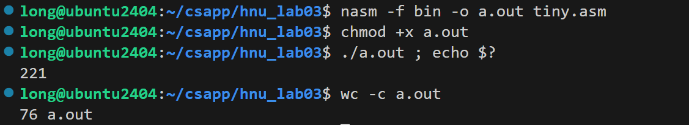

##### **进一步优化解析**
`org 0x08048000`改为: 
`org 0x00010000   ; 降低加载地址，让e_entry更短`

`dd 5            ; p_flags = 5` 改为:
`dd 4            ; p_flags = 4 读权限，改成只读，内核依然能执行`

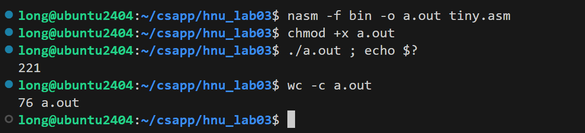

---

##### **问题解答**
> 问: 为什么加载地址可以被改到如此低的数字 ?

- **答**: 文件中所有地址偏移 (phdr 位置、代码位置) 不变, 因为 org 只影响虚拟地址计算, 不影响文件中的物理偏移 (这里 p_offset=0，文件头直接映射到虚拟地址)


> 问: P_flags字段为什么能这样修改?

- **答**: 对于可执行文件, Linux 内核在加载时, 一般会把自动把`.text`段设置为可执行, 即使p_flags没有设置执行权限

---

**阶段五解锁密钥:** `ELF-76`

---
---

### 2.6 阶段六 -- 终极极限挑战
本阶段尝试达到ELF可执行文件的绝对最小值, 利用Linux加载器的容错性, **移除文件末尾的零字节**.

##### **优化技巧参考**
1. **文件阶段**: Linux加载器会把零字节字段自动补零, 我们可以移除文件末尾的零字节.
2. **p_filesz和p_memsz的关系**: 当内存段制度是, p_memsz不能大于p_filesz (因为无法零初始化), 解决方案: 让p_filesz和p_memsz相等, 即使他们都比实际文件大.
3. **e_phoff的妙用**: e_phoff(程序头表偏移)的值为4, 恰好可以作为p_flags的值 (读权限)!

##### **完成终极代码**
```asm
BITS 32  
org   0x00100000  

ehdr:
    db    0x7F, "ELF"        ; e_ident[0..3] (4字节)  
phdr:
    dd    1                  ; e_ident[4..7], p_type = 1            ?
    dd    0                  ; e_ident[8..11], p_offset = 0         ?
    dd    $$                 ; e_ident[12..15], p_vaddr = 0x00100000  
    dw    2                  ; e_type = 2, p_paddr    高2字节         ?
    dw    3                  ; e_machine = 3, p_paddr 低2字节         ? 
    dd    _start             ; e_version = 1, p_filesz  
    dd    _start             ; e_entry = _start, p_memsz  
    dd    4                  ; e_phoff = 4, p_flags = 4              ?

```
续
```asm

_start:   ; (偏移18字节)
    mov   bl, 221       ; 2 字节: B3 DF  , e_shoff, p_align的高2字节   ?
    xor   eax, eax      ; 2 字节: 31 C0  , e_flags的前2字节, p_align的低2字节, phdr 结束
    inc   eax           ; 1 字节: 40     , e_flags的第3字节
    int   0x80          ; 2 字节: CD 80  , e_flags的最后1字节 和 填充
    db    0              ; 1 字节        , 填充                        ?

    dw    0x34           ; e_ehsize
    dw    0x20           ; e_phentsize
    db    1              ; ephnum的高1字节                             ?
    ; 补0                ; ephnu的低1字节, e_shentsize, e_shnum, e_shstmdx
filesize equ $ - $$
```

##### **编译并验证**
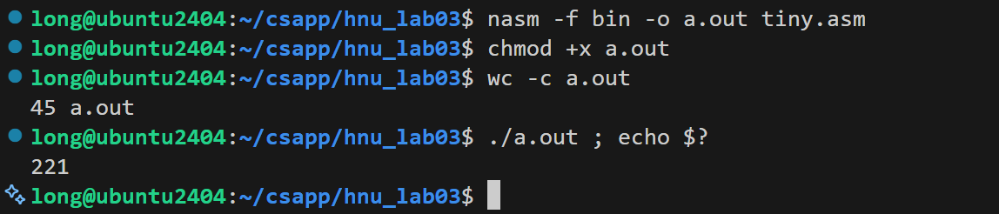

##### **问题思考**
> 问: 为什么 e_phnum可以使用1字节(db) 而不是 2字节(dw) ?

- **答**: 这里用到了**文件末尾的零字节被加载器自动补零**的技巧, `e_phnum`的高1字节被设置为1, 低1字节被设置为0, 这样在文件中只需要存储高1字节的值(1), 低1字节的值(0)可以通过加载器的自动补零来实现, 通过小端法读取, `e_phnum`的值仍然是1, 这样就节省了1字节

> 问: p_filesz 和 p_memsz 都比实际文件大小大很多, 为什么程序还能正常运行 ?

- **答**: `p_filesz` 和 `p_memsz` 的值为`0x00100018`, 远大于实际的可执行文件大小45字节, 
当读取到文件末尾时遇到EOF, 实际读取的数据只有45字节, 剩余部分由于`p_memsz`的值很大, 内核会把未读到的内存区域清零
因为代码和所有必要数据都位于文件的前 45 字节内, 所以程序能正确执. 这是对 ELF 标准的违规, 但 Linux 内核对此容忍.

> 问: 这个最小字节的程序有多少字段违反了ELF标准 ?
1. **ELF头与程序头重叠**: 相当于程序头嵌入了ELF头, 这样使得有很多字段都是重叠的, 例如: `e_phnum`和`p_type`重叠, `e_shentsize`和`p_offset`重叠, `e_shnum`和`p_vaddr`重叠, `e_shstrndx`和`p_paddr`重叠, 这些字段在ELF标准中是分开的, 但是在这个文件中他们重叠了
2. **p_filesz和p_memsz的值不合理**: 这两个字段的值远大于实际文件大小
3. **`p_flags`的值为4,** 只有读权限, 但是内核加载器会自动把代码段设置为可执行, 因此这个值虽然不合理, 但是仍然能正常运行
4. **`p_paddr`的值异常,** 有`dw 2, dw 3`拼接成`0x20003`, 并非通常的加载地址.

> 问: 从几十k字节优化到现在, 压缩比是多少 ?

- **答**: 从最开始的`14912`字节优化到现在的`45`字节, 压缩比为 `14912 / 45 ≈ 331.38`, 即原文件大小的约1/331

## 3 实验总结
### 3.1 密钥提交
|阶段|密钥|
|:-:|:-:|
|阶段一|`14912-13660-13660`|
|阶段二|`16968`|
|阶段三|`LD-4240`|
|阶段四|`175`|
|阶段五|`ELF-76`|
|阶段六|`45`|

### 3.2 实验心得
1. 从 C 程序编译优化, 汇编改写系统调用, 到手动构建 ELF 头, 结构重叠优化, 最终实现极限精简的 ELF 文件, 整个过程循序渐进, 一步一步深入理解了 Linux 可执行文件的内部结构和加载机制.
2. 实验让我彻底吃透了 ELF 文件的核心结构, 清晰区分了 ELF 头, 程序头表, 节头表的作用, 理解了节头表对可执行文件的非必要性, 也掌握了 Linux 系统调用 `int 0x80` 的使用逻辑. 同时, 我直观感受到编译器, 链接器的工作机制, 明白 GCC 默认引入大量冗余代码, 而通过nasm, ld及手动构造 ELF 结构, 能大幅精简文件体积。
3. 从最初 14KB 的 C 程序, 一步步优化到 45 字节的极限 ELF 文件, 这个过程锻炼了我的底层思维和极致优化意识, 也体会到理论与实践结合的重要性。此次实验加深了我对 Linux 底层, 程序加载运行机制的理解, 以及对相关命令行工具的透彻理解